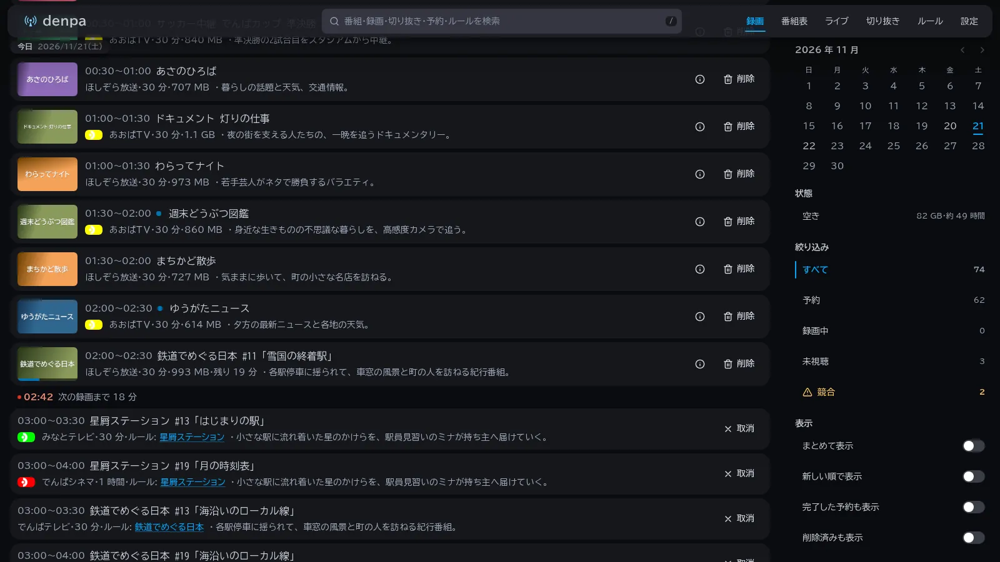
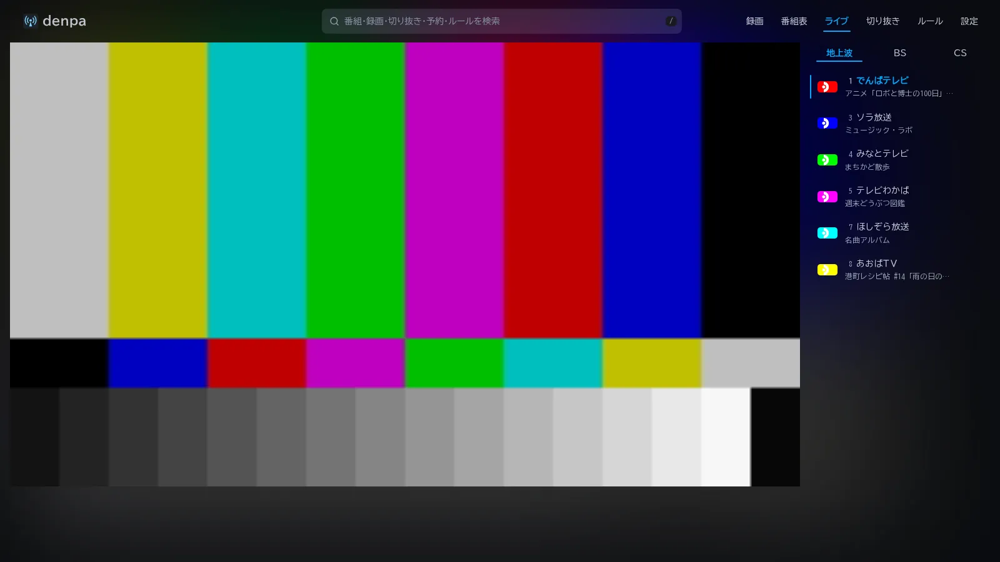
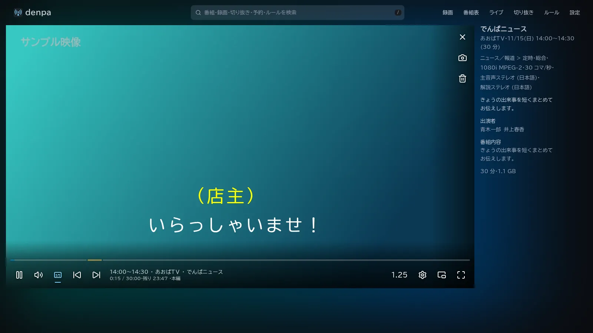

# denpa

文書は **[danything.github.io/denpa](https://danything.github.io/denpa/)** でも読めます。

**チューナーを挿して起動すれば、そのまま使える自宅用のテレビ録画サーバ**です。
設定ファイルは書かず、チューナーは種別 (地上波 / 衛星) まで自動で見分け、あとは画面でスキャンを押すだけ。
Mirakurun や EDCB、メディアサーバは要りません。番組表から予約し、CM は自動で飛ばし、
ライブも録画もブラウザで字幕・データ放送つきで観られます。テレビは専用のアプリ
[denpa-tv](https://github.com/danything/denpa-tv) で。

1.x から上げる人は [2.0 で変わったこと](docs/v2.md) (画面の場所・無くなった設定) を先に。

<p align="center">
  
</p>

<table>
  <tr>
    <td align="center"><a href="docs/screens.md#録画"></a><br><sub><b>録画</b><br>予約と録画を 1 本の一覧に。サムネイル付きで、押せばその場で観る</sub></td>
    <td align="center"><a href="docs/screens.md#ライブ"></a><br><sub><b>ライブ</b><br>字幕もデータ放送も。止めれば追っかけ</sub></td>
    <td align="center"><a href="docs/screens.md#録画を観る"></a><br><sub><b>観る</b><br>放送どおりの字幕、CM は自動で飛ばす</sub></td>
  </tr>
</table>

ほかの画面 (番組表・切り抜き・検索・ルール・設定) は [docs/screens.md](docs/screens.md)。

## 使ってよい範囲

denpa は、**自分の B-CAS カードで、自分の世帯の中で、私的に**録画して観るためのものです。

- 録画やライブを、世帯の外の人に観せない
- カードの鍵を、世帯の外の機器に配らない
- カードを書き換えない

端末 (ブラウザ) は外のサービスに繋ぎません。実況のコメント (設定でオンにしたとき) も、denpa のサーバが Doa の denpa-hub から受けて渡します。hub にはどの局をいつ観ているかが届きます ([docs/architecture.md](docs/architecture.md#実況のコメント-denpa-hub))。
ライブでは実況に書き込めます (ニコニコと連携している世帯では公式のニコニコ実況へ、ほかは denpa-hub へ。hub が NX-Jikkyo にも書きます)。書いたものは公開され、消せません ([docs/watch.md](docs/watch.md#実況に書き込む))。

考え方は [Discussion #760](https://github.com/danything/denpa/discussions/760) にまとめています (法律相談ではなく、議論のための整理です)。

## できること

- 番組表から押すか、検索から作るルールで自動で予約する。同じ回は最初の放送だけ録る
- 録画は CM を見つけてチャプターにし、AV1 / H.264 の mkv にエンコードする (GPU があれば H.265 も)。字幕は放送の ARIB 字幕のまま入れる。GPU (Intel・AMD・NVIDIA・Rockchip) があれば使う
- ライブは放送から 1 秒ほどで観られる。止めれば追っかけになり、二カ国語・解説放送も選べる ([docs/watch.md](docs/watch.md#ライブ))
- データ放送は、テレビと同じ BML がブラウザで動く (d ボタン)。ライブでも録画でも使える
- 録画は行を押せばその場で再生する。CM は 1 コマも見せずに飛ばし、続きからの再生・倍速 (×1〜×2)・切り抜き (字幕・コメントごとサーバに保存) もできる
- 字幕は放送どおりの位置に描く。番組名・局名も含めて Denpa Font で描き、外字まで崩さない
- 録画を端末に保存すれば、電波の無いところでも観られる ([docs/offline.md](docs/offline.md))
- EPGStation からはルール・予約・録画を、EDCB からはルール・予約・録画の履歴を引き継げる ([docs/migrate.md](docs/migrate.md))
- ルール・予約・録画の一覧・設定を書き出して、新しい機械の denpa に取り込める ([docs/migrate.md](docs/migrate.md#別の機械へ移す))

部品はチューナーで選局して素の TS を流す **チューナーエージェント** と、それ以外の全部 (番組表・予約・録画・
エンコード・配信) をやる **denpa** の 2 つだけです ([docs/architecture.md](docs/architecture.md))。

## 立てる

### 1. 要るもの

チューナー・B-CAS カードとカードリーダー・OS (Linux / Mac / Windows)・Docker (Linux だけ) が要ります。使えるチューナーの一覧と細かいことは [docs/tuners.md](docs/tuners.md#要るもの)。
表に無い機材は、機材を貸していただくか譲っていただければ対応します ([docs/tuners.md](docs/tuners.md#表に無い機材実機で確かめていない機材))。

### 2. 入れる

**1 行で、denpa 本体とチューナーのエージェントの両方が立ち上がり、ブラウザが開きます。** clone は要りません。

```sh
# Linux
curl -fsSL https://raw.githubusercontent.com/danything/denpa/main/install.sh | bash
# Mac (Apple Silicon。管理者のパスワードを聞かれる)
curl -fsSL https://raw.githubusercontent.com/danything/denpa/main/install.sh | sudo bash
```

```powershell
# Windows (管理者の PowerShell。本体を動かすユーザーの Windows のパスワードを聞かれる。Enter だけなら SYSTEM で動かす)
irm https://raw.githubusercontent.com/danything/denpa/main/install.ps1 | iex
```

OS ごとの置き場、Compose を手で置くとき、上げ方と設定の書き場所は [docs/install.md](docs/install.md#1-行で入れる)。

### 3. 開く

- <http://denpa.localhost> (Linux で [genkan](https://github.com/danything/genkan) を入れられたとき) か
  `http://<IP>:3000` (Mac と Windows は <http://localhost:3000>)。LAN のほかの機器 (テレビ・スマホ) からも `http://<IP>:3000`
- 誰を通すかを設定するまでは、全部断ります。compose の `TRUSTED_NETWORKS` の初期値は家の中 (私設網) で、
  ここからはログインなしで通ります。範囲の変え方と、画面をログイン (OIDC) で守るときは
  [docs/install.md](docs/install.md#誰を通すか)
- 設定の「受信」の「チューナー」で見つかったチューナーを確かめ、「チャンネル」で**スキャン**を押します (局が 1 つも無いうちは、録画・番組表・ライブの上に案内が出ます)。衛星は最初から局が入っていて、
  地上波は十数分。終わると番組表を集めるので (数分)、あとは番組表から予約するだけです
- **カードリーダーが「エラー」のまま録ると、中身はスクランブルされたままです** (設定の「受信」の「チューナー」に出ます)

1 コンテナ (`denpa-aio`)・Helm・リバースプロキシの後ろに置くとき・困ったときは [docs/install.md](docs/install.md)、
ログインの細かいことは [docs/auth.md](docs/auth.md)。

## 観る

- ブラウザで観る。ホーム画面にも置ける ([docs/watch.md](docs/watch.md#ホーム画面に置く))
- テレビ (Android TV / Fire TV) は [denpa-tv](https://github.com/danything/denpa-tv)。テレビに出る QR をスマホで読めば繋がる
- 外から使う API で、局・録画の一覧、ライブ、音声だけを取れる (Home Assistant やスクリプト向け。[docs/api.md](docs/api.md))

## もっと詳しく

**はじめる**

- [docs/install.md](docs/install.md) — **立てる** (入れ方の選択肢・1 コンテナ・Helm・前段の後ろに置く)
- [docs/install-mac.md](docs/install-mac.md) — Mac に入れる
- [docs/install-windows.md](docs/install-windows.md) — Windows に入れる
- [docs/install-android.md](docs/install-android.md) — Android の端末にチューナーを挿し、1 台で denpa を動かすか、家の denpa のエージェントにする (実機で確かめていない)
- [docs/install-talos.md](docs/install-talos.md) — Talos Linux の 1 台に、OS の設定から 1 行で入れる (PT3。実機で確かめていない)
- [docs/screens.md](docs/screens.md) — 画面 (実機のスクリーンショット)
- [docs/faq.md](docs/faq.md) — よくある質問
- [docs/v2.md](docs/v2.md) — 2.0 で変わったこと

**チューナー**

- [docs/tuners.md](docs/tuners.md) — **使えるチューナー** (一覧・カードリーダー・B-CAS・直らないとき)
- [docs/tuner-pt3.md](docs/tuner-pt3.md) — PT3 など (Linux DVB。実機で確かめていない機材も)
- [docs/tuner-it930x.md](docs/tuner-it930x.md) — PX-MLT5 系・PX-Q3U4・PX-W3U4 など (IT930x の機材)
- [docs/tuner-px-s1ud.md](docs/tuner-px-s1ud.md) — PX-S1UD
- [docs/tuner-xbox-one.md](docs/tuner-xbox-one.md) — Xbox One Digital TV Tuner (ケーブルだけ)

**乗り換え**

- [docs/switch.md](docs/switch.md) — **ほかの録画ソフトから乗り換える** (Mirakurun・EPGStation・EDCB など)
- [docs/migrate.md](docs/migrate.md) — **EPGStation・EDCB からの引き継ぎ**と、**別の機械へ移す**

**使う**

- [docs/watch.md](docs/watch.md) — **観る** (ライブ・操作バー・ホーム画面に置く)
- [docs/offline.md](docs/offline.md) — 端末に保存して電波の無いところで観る
- [docs/library.md](docs/library.md) — 録画の置き場と配り方 (テレビのアプリ・削除・通知)

**運用**

- [docs/config.md](docs/config.md) — **環境変数** (一覧と、前のバージョンから上げるとき)
- [docs/auth.md](docs/auth.md) — **誰を通すか** (OIDC・信頼するネットワーク・ペアリング)

**外から使う**

- [docs/api.md](docs/api.md) — **外から使う API**

**仕組み**

- [docs/architecture.md](docs/architecture.md) — **なぜこの作りなのか** (決めたこと・踏んだ落とし穴・画面で動いてよいもの (CSP))
- [docs/agent.md](docs/agent.md) — **チューナーエージェント** (取り合い・共有・選局・設定ファイル・B25・鍵の配布)
- [docs/data.md](docs/data.md) — エージェントに都度聞くもの / denpa が持つもの
- [docs/stream.md](docs/stream.md) — ライブの仕組み ([経緯](docs/stream-history.md))
- [docs/player.md](docs/player.md) — 観る画面の作り
- [docs/encode.md](docs/encode.md) — エンコード (字幕・AV1・GPU)
- [docs/cm.md](docs/cm.md) — CM 検出
- [docs/logo.md](docs/logo.md) — 局ロゴ (番組表の PNG と CM 検出用に覚えたロゴ)

**手を入れる**

- [docs/development.md](docs/development.md) — **手を入れるとき** (開発環境・テスト)
- [docs/app.md](docs/app.md) — **どこに何があるか** (ファイル・画面・状態遷移・テスト)
- [docs/writing.md](docs/writing.md) — 書き方 (画面・docs・コメントの言葉)
- [docs/design.md](docs/design.md) — 見た目の決まり
- [docs/licenses.md](docs/licenses.md) — 借りているもの

動いた/動かなかったを [Issue](https://github.com/danything/denpa/issues) で教えてもらえると助かります。

## 困ったとき

**不具合と質問は [Issue](https://github.com/danything/denpa/issues) で受け付けます。** 設定の「その他」→「ログ」の「Issue にする」を押すと、
バージョンと環境とログが入った Issue を作れます。内容を確かめてから送ってください。
Issue を送るには GitHub のアカウント (無料) が要ります。無ければ [作ってから](https://github.com/signup) 送ってください。
X などの DM での個別の対応は、[GitHub Sponsors](https://github.com/sponsors/5ym) で支援してくださっている方だけにしています。

## 謝辞

**特別協賛**:

<a href="https://github.com/eggplants"></a>

[**@eggplants**](https://github.com/eggplants) (haruna) さんが、GitHub Sponsors で denpa を大きく支えてくれました。本当にありがとうございます。

<!-- 下の印の間は scripts/thanks.ts が履歴から書く。手で直さない -->
<!-- thanks:start -->

**手を入れてくれた人** (ありがとうございます):

<table>
<tr><td align="center"><a href="https://github.com/danything/denpa/pulls?q=is%3Apr+is%3Amerged+author%3AKhronos31"><br><sub>@Khronos31</sub></a></td><td align="center"><a href="https://github.com/danything/denpa/pulls?q=is%3Apr+is%3Amerged+author%3Aunlimish"><br><sub>@unlimish</sub></a></td><td align="center"><a href="https://github.com/danything/denpa/pulls?q=is%3Apr+is%3Amerged+author%3Afetburner"><br><sub>@fetburner</sub></a></td><td align="center"><a href="https://github.com/danything/denpa/pulls?q=is%3Apr+is%3Amerged+author%3Asirius128"><br><sub>@sirius128</sub></a></td><td align="center"><a href="https://github.com/danything/denpa/pulls?q=is%3Apr+is%3Amerged+author%3Achiroru27"><br><sub>@chiroru27</sub></a></td><td align="center"><a href="https://github.com/danything/denpa/pulls?q=is%3Apr+is%3Amerged+author%3Aminetaro12"><br><sub>@minetaro12</sub></a></td><td align="center"><a href="https://github.com/danything/denpa/pulls?q=is%3Apr+is%3Amerged+author%3Aharuki0420"><br><sub>@haruki0420</sub></a></td></tr>
</table>

**報告や提案をくれた人** (ありがとうございます):

<table>
<tr><td align="center"><a href="https://github.com/danything/denpa/issues?q=author%3AKhronos31"><br><sub>@Khronos31</sub></a></td><td align="center"><a href="https://github.com/danything/denpa/issues?q=author%3Aunlimish"><br><sub>@unlimish</sub></a></td><td align="center"><a href="https://github.com/danything/denpa/issues?q=author%3Akametani-mikihiro"><br><sub>@kametani-mikihiro</sub></a></td><td align="center"><a href="https://github.com/danything/denpa/issues?q=author%3Afetburner"><br><sub>@fetburner</sub></a></td><td align="center"><a href="https://github.com/danything/denpa/issues?q=author%3Ashino-zxc"><br><sub>@shino-zxc</sub></a></td><td align="center"><a href="https://github.com/danything/denpa/issues?q=author%3Aeggplants"><br><sub>@eggplants</sub></a></td><td align="center"><a href="https://github.com/danything/denpa/issues?q=author%3Aogatomo21"><br><sub>@ogatomo21</sub></a></td></tr>
<tr><td align="center"><a href="https://github.com/danything/denpa/issues?q=author%3Ayuki-untitled"><br><sub>@yuki-untitled</sub></a></td><td align="center"><a href="https://github.com/danything/denpa/issues?q=author%3Aorijie"><br><sub>@orijie</sub></a></td><td align="center"><a href="https://github.com/danything/denpa/issues?q=author%3Aemuiak"><br><sub>@emuiak</sub></a></td><td align="center"><a href="https://github.com/danything/denpa/issues?q=author%3Aharuki0420"><br><sub>@haruki0420</sub></a></td><td align="center"><a href="https://github.com/danything/denpa/issues?q=author%3Amasa592"><br><sub>@masa592</sub></a></td><td align="center"><a href="https://github.com/danything/denpa/issues?q=author%3Atukiboshi389"><br><sub>@tukiboshi389</sub></a></td><td align="center"><a href="https://github.com/danything/denpa/issues?q=author%3Astrugglecrow"><br><sub>@strugglecrow</sub></a></td></tr>
<tr><td align="center"><a href="https://github.com/danything/denpa/issues?q=author%3Aiwkta"><br><sub>@iwkta</sub></a></td><td align="center"><a href="https://github.com/danything/denpa/issues?q=author%3Ajunhayasaka"><br><sub>@junhayasaka</sub></a></td><td align="center"><a href="https://github.com/danything/denpa/issues?q=author%3Apixnook"><br><sub>@pixnook</sub></a></td><td align="center"><a href="https://github.com/danything/denpa/issues?q=author%3Aono-setai-13"><br><sub>@ono-setai-13</sub></a></td><td align="center"><a href="https://github.com/danything/denpa/issues?q=author%3Apachiris"><br><sub>@pachiris</sub></a></td></tr>
</table>

<!-- thanks:end -->

## Code signing policy

Free code signing provided by [SignPath.io](https://about.signpath.io), certificate by [SignPath Foundation](https://signpath.org)

- Committers and reviewers: [5ym](https://github.com/5ym)
- Approvers: [Owners](https://github.com/orgs/danything/people?query=role%3Aowner)
- Privacy policy: [Privacy](#privacy)

Code signing is planned and has not started yet: current releases are not signed.
Once it starts, `denpa-agent.exe` and `denpa-tray.exe` in `denpa-agent-<version>-windows-x64.zip` are signed for every release.
Upstream binaries (bun, FFmpeg and its DLLs, libwdi's `wdi-simple.exe`) are shipped as they are and are not signed with this certificate.
`asicen\denpa-asicen.exe` (the GPL-2.0 child process for ASICEN tuners, built from asicen-userland) is not signed either: it is built from upstream code that this project does not maintain.

Windows のエージェントの zip にある `denpa-agent.exe` と `denpa-tray.exe` を、SignPath Foundation の証明書でリリースのたびに署名する予定です。
**今のリリースはまだ署名していません。** 上流のもの (bun・FFmpeg と DLL・libwdi の `wdi-simple.exe`) と、asicen-userland から組む ASICEN の子プロセス (`asicen\denpa-asicen.exe`) は署名しません。
署名するものと、しないものの判断は [docs/install-windows.md](docs/install-windows.md#コード署名) にあります。

### Privacy

- The signed programs connect to the denpa server and to the devices on the LAN that the user sets up. The only exception is the update below.
  `denpa-agent.exe` serves the denpa server and, when the user turns on card sharing, other agents on the LAN.
  It announces itself on the LAN with mDNS so that the denpa server can find it (no pairing token or card data in the announcement).
  `denpa-tray.exe` calls only the denpa server (or the agent) on the same PC.
  When the user chooses the update in its menu, it runs `install.ps1`, which downloads the release from GitHub
- The denpa server checks [GitHub](https://docs.github.com/site-policy/privacy-policies/github-general-privacy-statement) for a new release
  when it starts and once an hour (`https://api.github.com/repos/danything/denpa/releases/latest`).
  GitHub sees the IP address of the server and the version of denpa (in the User-Agent). No user data is sent
- When data broadcasting or a Hybridcast app asks for a broadcaster's server, the denpa server fetches it for the browser
  (public addresses only, names resolved with `1.1.1.1` and `8.8.8.8`). This can be turned off in the settings
- Other external services are used only when the user turns them on:
  live comments, NicoNico integration and program ranking (denpa-hub, run by the maintainer; denpa-hub reads NX-Jikkyo and the NicoNico Jikkyo past log API),
  notifications to the webhooks that the user enters, login with the OpenID Connect provider that the user sets up,
  and moving from EPGStation or EDCB at the address that the user enters.
  What each service can see is in [docs/architecture.md](docs/architecture.md#実況のコメント-denpa-hub) (Japanese)

署名する実行ファイルは、通知領域のアイコンのメニューで更新を選んだときを除き、denpa のサーバと、利用者が設定した LAN の機器にだけ繋ぎます。更新を選ぶと、通知領域のアイコンが install.ps1 を流し、GitHub からリリースを取得します。エージェントは、denpa のサーバが見つけられるように、mDNS で LAN にサービスを公開します (合言葉とカードの情報は入れない)。
denpa のサーバは、起動したときと 1 時間ごとに、新しいバージョンを確かめるために GitHub に繋ぎます。GitHub に見えるのは、サーバの IP と denpa のバージョンです。
データ放送と Hybridcast のアプリが放送局のサーバを求めたときは、denpa のサーバが代わりに取得します (公開のアドレスだけ。名前は `1.1.1.1` と `8.8.8.8` で引く)。設定で止められます。
ほかの外のサービス (実況のコメント、ニコニコとの連携と番組ランキングの denpa-hub、利用者が入れた Webhook への通知、利用者が設定した OpenID Connect でのログイン、利用者が入れたアドレスの EPGStation・EDCB からの引き継ぎ) は、オンにしたときだけ使います。

## ライセンス

**AGPL-3.0-or-later** ([LICENSE](LICENSE))。ネットワーク越しに使わせる形で配るなら、その中身も同じ条件で
渡せるようにしてほしい、という理由で選んでいます。借りているもの (ffmpeg・Denpa Font ほか) は
元のライセンスのままで、一覧は [docs/licenses.md](docs/licenses.md)。

チューナーエージェント (`agent/`) だけは **MPL-2.0** ([agent/LICENSE](agent/LICENSE))。ほかのソフトに組み込んだり一緒に配ったりできる一方で、
エージェントのファイルを直して配るなら、そのファイルは同じ条件で公開してください。
ASICEN 系の機材の子プロセス (`agent/asicen/`。asicen-userland を組み込んだ `denpa-asicen`) は **GPL-2.0-only** の別のプログラムで、
エージェントとは標準入出力でやりとりするだけなので、エージェントは MPL-2.0 のままです ([docs/licenses.md](docs/licenses.md#asicen-の子プロセス))。
