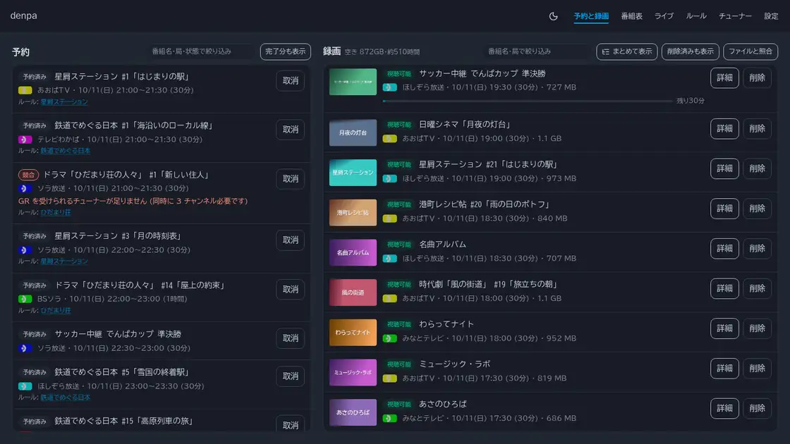
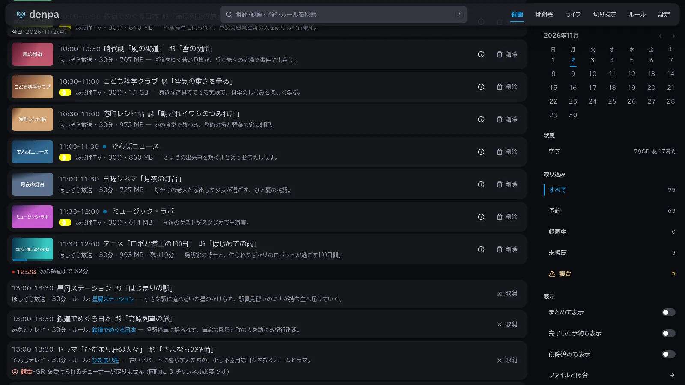
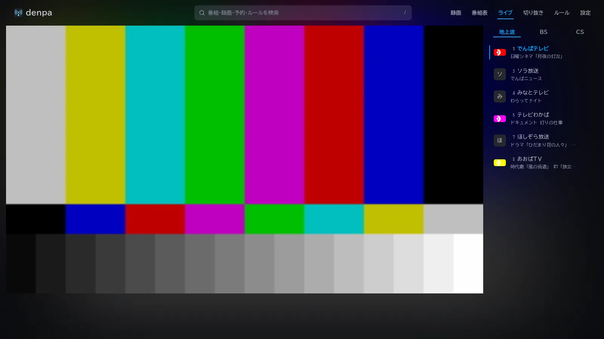
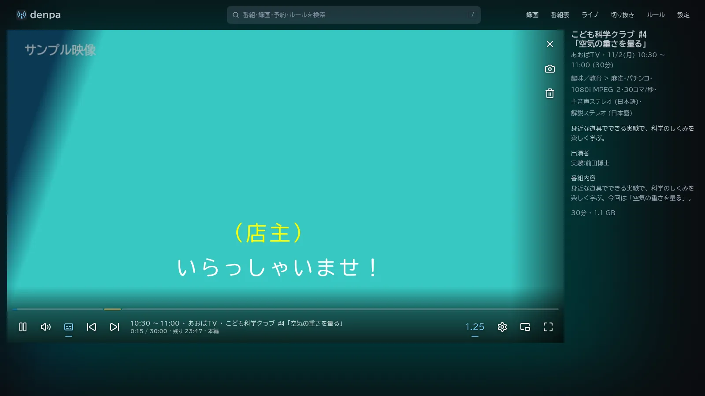

# denpa

文書は **[danything.github.io/denpa](https://danything.github.io/denpa/)** でも読めます。

**チューナーを挿して起動すれば、そのまま使える自宅用のテレビ録画サーバ**です。
設定ファイルは書かず、チューナーは種別 (地上波 / 衛星) まで自動で見分け、あとは画面でスキャンを押すだけ。
Mirakurun や EDCB、メディアサーバは要りません。番組表から予約し、CM は自動で飛ばし、
ライブも録画もブラウザで字幕・データ放送つきで観られます。テレビは専用のアプリ
[denpa-tv](https://github.com/danything/denpa-tv) で。

1.x から上げる人は [2.0 で変わったこと](docs/v2.md) (画面の場所・無くなった設定) を先に。

<p align="center">
  
</p>

<table>
  <tr>
    <td align="center"><a href="docs/screens.md#録画"></a><br><sub><b>録画</b> — 予約と録画を 1 本の一覧に。サムネ付きで、押せばその場で観る</sub></td>
    <td align="center"><a href="docs/screens.md#ライブ"></a><br><sub><b>ライブ</b> — 字幕もデータ放送も。止めれば追っかけ</sub></td>
    <td align="center"><a href="docs/screens.md#録画を観る"></a><br><sub><b>観る</b> — 放送どおりの字幕、CMは自動で飛ばす</sub></td>
  </tr>
</table>

ほかの画面 (番組表・検索・ルール・設定) は [docs/screens.md](docs/screens.md)。

## 使ってよい範囲

denpa は、**自分の B-CAS カードで、自分の世帯の中で、私的に**録画して観るためのものです。

- 録画やライブを、世帯の外の人に観せない
- カードの鍵を、世帯の外の機器に配らない
- カードを書き換えない

考え方は [Discussion #760](https://github.com/danything/denpa/discussions/760) にまとめています (法律相談ではなく、議論のための整理です)。

## できること

- **予約** — 番組表から押すか、検索から作るルールで自動で。同じ回は最初の放送だけ録る
- **録画** — CM を見つけてチャプターにし、AV1 / H.264 の mkv にエンコードする。字幕は放送の ARIB 字幕のまま入れる。Intel の GPU があれば使う
- **ライブ** — 放送から 1 秒ほどで。止めれば追っかけ、二カ国語・解説放送も選べる ([docs/watch.md](docs/watch.md#ライブ))
- **データ放送** — テレビと同じ BML がブラウザで動く (d ボタン)。ライブでも録画でも
- **観る** — 行を押せばその場で再生。CM は1コマも見せずに飛ばし、続きから・倍速 (×1〜×2)・切り抜き (字幕ごと PNG)
- **字幕と放送の字** — 字幕は放送どおりの位置に描き、番組名・局名も含めて Denpa Font で外字まで崩さない
- **端末に保存して観る** — 電波の無いところでも ([docs/offline.md](docs/offline.md))
- **EPGStation・EDCB から引き継ぐ** — ルール・予約・録画 (EDCB は録画の履歴) ([docs/migrate.md](docs/migrate.md))
- **別の機械へ移す** — ルール・予約・録画の一覧・設定を書き出して、新しい機械の denpa に取り込む ([docs/migrate.md](docs/migrate.md#別の機械へ移す))

部品はチューナーで選局して素の TS を流す **チューナーエージェント** と、それ以外の全部 (番組表・予約・録画・
エンコード・配信) をやる **denpa** の2つだけです ([docs/architecture.md](docs/architecture.md))。

## 立てる

### 1. 要るもの

チューナー・B-CASカードとカードリーダー・OS (Linux / Mac / Windows)・Docker (Windows は WSL) が要ります。使えるチューナーの一覧と細かいことは [docs/tuners.md](docs/tuners.md#要るもの)。

### 2. 入れる

**1行で、denpa 本体とチューナーのエージェントの両方が立ち上がり、ブラウザが開きます。** clone は要りません。

```sh
# Linux / Mac
curl -fsSL https://raw.githubusercontent.com/danything/denpa/main/install.sh | bash
```

```powershell
# Windows (PowerShell)
irm https://raw.githubusercontent.com/danything/denpa/main/install.ps1 | iex
```

OS ごとの置き場、Compose を手で置くとき、上げ方と設定の書き場所は [docs/install.md](docs/install.md#1行で入れる)。

### 3. 開く

- <http://denpa.localhost> (Linux・Mac で [genkan](https://github.com/danything/genkan) を入れられたとき) か
  `http://<IP>:3000` (Windows は <http://localhost:3000>)。LAN のほかの機器 (テレビ・スマホ) からも `http://<IP>:3000`
- **誰を通すか** — 設定するまで全部断ります。compose の `TRUSTED_NETWORKS` の初期値は家の中 (私設網) で、
  ここからはログインなしで通ります。範囲の変え方と、画面をログイン (OIDC) で守るときは
  [docs/install.md](docs/install.md#誰を通すか)
- 設定の「受信」の「チューナー」で見つかったチューナーを確かめ、「チャンネル」で**スキャン**を押します (局が1つも無いうちは、録画・番組表・ライブの上に案内が出ます)。衛星は最初から局が入っていて、
  地上波は十数分。終わると番組表を集めるので (数分)、あとは番組表から予約するだけです
- **カードリーダーが NG のまま録ると、中身はスクランブルされたままです** (設定の「受信」の「チューナー」に出ます)

1コンテナ (`denpa-aio`)・Helm・リバースプロキシの後ろに置くとき・困ったときは [docs/install.md](docs/install.md)、
ログインの細かいことは [docs/auth.md](docs/auth.md)。

## 観る

- **ブラウザ** — ホーム画面にも置ける ([docs/watch.md](docs/watch.md#ホーム画面に置く))
- **テレビ** (Android TV / Fire TV) — [denpa-tv](https://github.com/danything/denpa-tv)。テレビに出る QR をスマホで読めば繋がる
- **外から使う API** — 局・録画の一覧、ライブ、音声だけ (Home Assistant やスクリプト向け。[docs/api.md](docs/api.md))

## もっと詳しく

**はじめる**

- [docs/install.md](docs/install.md) — **立てる** (入れ方の選択肢・1コンテナ・Helm・前段の後ろに置く)
- [docs/install-mac.md](docs/install-mac.md) — Mac に入れる
- [docs/install-windows.md](docs/install-windows.md) — Windows に入れる
- [docs/screens.md](docs/screens.md) — 画面 (実機のスクリーンショット)
- [docs/faq.md](docs/faq.md) — よくある質問
- [docs/v2.md](docs/v2.md) — 2.0 で変わったこと

**チューナー**

- [docs/tuners.md](docs/tuners.md) — **使えるチューナー** (一覧・カードリーダー・B-CAS・直らないとき)
- [docs/tuner-pt3.md](docs/tuner-pt3.md) — PT2・PT3・PX-BCUD (Linux DVB)
- [docs/tuner-px4.md](docs/tuner-px4.md) — PX-Q3U4・PX-W3U4・PX-MLT (px4-userland)
- [docs/tuner-px-s1ud.md](docs/tuner-px-s1ud.md) — PX-S1UD (siano-userland)

**乗り換え**

- [docs/switch.md](docs/switch.md) — **ほかの録画ソフトから乗り換える** (Mirakurun・EPGStation・KonomiTV・EDCB)
- [docs/migrate.md](docs/migrate.md) — **EPGStation・EDCB からの引き継ぎ**と、**別の機械へ移す**

**使う**

- [docs/watch.md](docs/watch.md) — **観る** (ライブ・操作バー・ホーム画面に置く)
- [docs/offline.md](docs/offline.md) — 端末に保存して電波の無いところで観る
- [docs/library.md](docs/library.md) — 録画の置き場と配り方 (テレビのアプリ・削除・通知)

**運用**

- [docs/config.md](docs/config.md) — **環境変数** (一覧と、前のバージョンから上げるとき)
- [docs/auth.md](docs/auth.md) — **誰を通すか** (OIDC・信頼したネットワーク・ペアリング)

**外から使う**

- [docs/api.md](docs/api.md) — **外から使う API**

**仕組み**

- [docs/architecture.md](docs/architecture.md) — **なぜこの作りなのか** (決めたこと・踏んだ落とし穴・画面で動いてよいもの (CSP))
- [docs/app.md](docs/app.md) — **どこに何があるか** (ファイル・画面・状態遷移・テスト)
- [docs/agent.md](docs/agent.md) — **チューナーエージェント** (取り合い・共有・選局・設定ファイル・B25・鍵の配布)
- [docs/data.md](docs/data.md) — エージェントに都度聞くもの / denpa が持つもの
- [docs/stream.md](docs/stream.md) — ライブの仕組み ([経緯](docs/stream-history.md))
- [docs/player.md](docs/player.md) — 観る画面の作り
- [docs/encode.md](docs/encode.md) — エンコード (字幕・AV1・GPU)
- [docs/cm.md](docs/cm.md) — CM 検出
- [docs/logo.md](docs/logo.md) — 局ロゴ (番組表の PNG と CM検出用に覚えたロゴ)
- [docs/development.md](docs/development.md) — **手を入れるとき** (開発環境・テスト)
- [docs/writing.md](docs/writing.md) — 書き方 (画面・docs・コメントの言葉)
- [docs/design.md](docs/design.md) — 見た目の決まり
- [docs/licenses.md](docs/licenses.md) — 借りているもの

動いた/動かなかったを [Issue](https://github.com/danything/denpa/issues) で教えてもらえると助かります。

## 謝辞

**手を入れてくれた人** (ありがとうございます):

- [@Khronos31](https://github.com/Khronos31) — px4-userland / siano-userland で選局できなかったのを、PX-Q3U4 の実機で見つけて直してくれました (#188)。ほかにも不具合を報告してくれました (#195 #376 #377)
- [@unlimish](https://github.com/unlimish) — ライブ・追っかけ・観る画面に小窓 (PiP) を足してくれました (#431)。非力な機材で複数のライブを観るときの詰まりを実測つきで報告してくれ、ライブを GPU でエンコードできるようになりました (#417)
- [@fetburner](https://github.com/fetburner) — ルール画面の下見でチューナーの取り合いを数えるところを、時刻順に1回なぞるやり方にして、全件で 20 倍ほど速くしてくれました (#662)
- [@sirius128](https://github.com/sirius128) — 古い Intel の内蔵 GPU (Haswell など) でも GPU でエンコードできるように、イメージに i965 のドライバを足してくれました。Pentium G3250 と PT3 の実機で確かめてくれています (#775)

**土台にしている仕事**:

- [px4-userland](https://github.com/Khronos31/px4-userland) / [siano-userland](https://github.com/Khronos31/siano-userland) (@Khronos31) — ホストにドライバを入れずにチューナーを使えるのはこれのおかげです。PX-MLT5PE / DTV02A-5TS-P の対応は @siketyan
- [web-bml](https://github.com/otya128/web-bml) (otya128) — データ放送は長くこれで描いていました。自前のエンジン (`src/lib/bml/`) は、その振る舞いを手本にしています

## ライセンス

**AGPL-3.0-or-later** ([LICENSE](LICENSE))。ネットワーク越しに使わせる形で配るなら、その中身も同じ条件で
渡せるようにしてほしい、という理由で選んでいます。借りているもの (ffmpeg・Denpa Font ほか) は
元のライセンスのままで、一覧は [docs/licenses.md](docs/licenses.md)。
