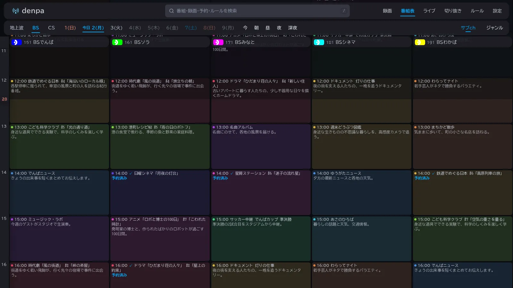
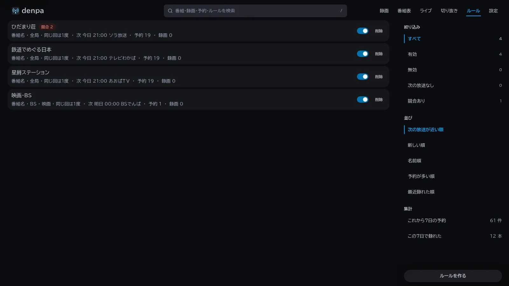

# 画面

偽の放送 (作り物の局・番組・映像) で撮った画像です。撮り直し方は [development.md](development.md#readme-の画像)。

立て方は [install.md](install.md)。

## 録画

予約と録画を**1本の一覧**に並べます。下へ行くほど時間が進みます。上から録れたもの (古い順)、
いま録っている行、赤い「いま」、これからの予約 (近い順) です。いまより前に始まったものは録画中も含めて「いま」より上に来ます。
「いま」は赤い点と赤い時刻で示し、すぐ後ろに次の録画まで何分かを添えます (線は引きません)。**録画中は「いま」を出さず**、いちばん上の録画中の行の
進み具合のバーの先にいまの時刻を出します (いまは録っている番組の途中なので)。日付ごとに見出しが付き、
一覧の頭に貼り付きます。開いたときは、観終えていない録画があればいちばん古いものを映し
(溜まったぶんを古い順に片付けられるように)、無ければ「いま」を映します。

行は幅いっぱいの2段です。1段目に時刻と番組名、右に押すもの。2段目に局・尺・ルール・番組の説明の頭が入ります。
状態は言うことがあるときだけ3段目に出します。いま動いていること (録画中・エンコード中・エンコード待ち・端末に保存中) も、
止まっている問題 (競合・失敗・録り逃し・欠ける・CM の判定・削除済み・取り消し済みなど) も同じ形で、頭に点か印、状態、
「・」の後ろにあと何分か・進み・理由が続きます (「● 録画中・あと21分」「✕ 競合・チューナーが足りません」)。段は2つまでで、動いているものが先、
問題は重いものから。収まらないときは2段目に残りの状態をつなぎます (理由は詳細で読めます)。
動いているものは下端にバーも敷きます (録画は赤、エンコードは主の色、端末への保存は緑)。ふつうの状態 (予約済み・視聴可能) は出しません。
行は線も枠も無い面に乗り、行の間の余白で1本ずつに見えます。触れると行全体の面の色が少し変わります。行の高さはマウスで 64px、指で押す端末では 72px です。

録画の行は左にサムネイル (途中まで観たものは下端に細いバー) が付き、押せばその場で観る画面へ
(録っている最中のものは「いま」のすぐ上にいて、その行の「追っかけ」で追っかけ再生へ。[library.md](library.md#観るのはブラウザで))。
中身を読むときは行の ⓘ から。予約の行を押すと番組の詳細が開きます。

広い画面 (1000px 以上。折り畳み端末のテーブルトップは除く) では、右にサイドバーが出ます (頭の1行は出さず、一覧はいちばん上から始まります)。よく使うものほど上で、次の順です。

- **カレンダー**: 月の升目。行のある日は濃い字で、押すとその日の見出しへ送ります。行の無い日は薄い字で押せません。今日は赤い点、選んでいる日は下線です。まとめて表示のときは出ません
- **状態**: エンコード (進みとあと何分か)・空き (あと何時間録れるかの目安)
- **絞り込み**: すべて・予約・録画中・未視聴。どれにも件数が付き、選んでいるものは左の縦線と主の色の太字で示します (未視聴は観終えていない録画。途中まで観たものも入ります)。
  続けて、競合・失敗・録り逃し・CMの判定 (ロゴで CM を判定できなかった録画) のうち件数のあるものが、注意の色とアイコンで出ます。押すとそれで絞られ、もう一度押すと戻ります
- **表示** (いちばん下): まとめて表示・完了した予約も表示・削除済みも表示 (右のスイッチ)、ファイルと照合 (→)。完了した予約のうち録画のあるものは録画の行1本にまとめ、録画の無いもの (取消など) だけを状態付きで出します

それより狭い画面 (タブレット・スマホ・狭めた窓) とテーブルトップでは、下のタブのすぐ上に細い1行を出します (下へ巻くと下のタブと一緒に隠れ、戻すと出ます)。絞り込みのチップ (1回押せば絞れ、横に流せます) と、
その後ろに競合・失敗などのうち件数のあるものを注意の色のチップで。右の「⋯」の頭に状態 (押せません)、その下に表示の切り替えがあります。

768px より狭い画面では、録画の行の詳細と削除は、番組名に幅を回すため右の「⋯」にまとめます。
番組名で探すのは、ホームではなく全体の検索です。

録画の行を押すと、そのまま観る画面へ:

予約や録画が溜まってきたら、「まとめて表示」で**番組ごと**にまとめられます
(端末ごとに覚えます)。まとめる単位は、エンコード済みの動画を置くシリーズのフォルダと同じです。
予約にも録画にも効き、同じ番組でも録画は「いま」より上、予約は下と、側ごとに別の見出しになります。録画中の行はまとめずに、録画の側の末尾 (「いま」のすぐ上) にそのまま出ます
(番組の位置は、予約は次の回、録画は最新の回で決まります)。見出しを押すと放送順に開きます。
1本しか無い番組はまとめずにふつうの行のまま出ます。開いた番組の頭と、録画の詳細には
「ルールを作る」があり、シリーズ名を言葉にして検索の画面の「ルールとして保存」へ行きます
(既にその番組を録っているルールがあれば、作らずにそちらを案内します)。

「詳細」で番組の中身と操作。主のボタン (太字) は「再生」だけで、ほかに「端末に保存」
(オフライン視聴)、「ルールを作る」、切り抜きがあれば「この録画の切り抜き」、「その他…」に視聴済みにする (未視聴に戻す)・再エンコード・CM検出のやり直し。閉じるのは左下の「閉じる」。640px より狭い画面では下から出る一枚になり、ボタンは全幅で縦に並びます。
録画をファイルとして持ち出すダウンロードはありません ([library.md](library.md#観るのはブラウザで))。
コマ数 (30/60) や字幕の有無もここに出ます。

## 番組表

局ごとの縦の列。マスの時刻の前の点がジャンルの色で、後ろの印と太字の言葉が予約の状態 (予約済み・録画中・競合) です。
放送が過ぎた所はマスが沈み、時の列に「いま」の時刻が出ます。
上の1行 (1000px より狭い画面では下のタブのすぐ上。表を下へ巻くと下のタブと一緒に隠れ、戻すと出ます) で日付を選び、朝・昼・夜へ送れます。「ジャンル」で色の見本を出し、押すとそのジャンルだけ目立ちます。
マスを押せば詳細が開いてそこから予約・取消。番組を言葉で探すのは[検索](#検索)です。
放送が話数を言っている番組は、詳細のジャンルの前に「第3話 (全12話)」「最終回」「再放送」と出ます ([data.md](data.md#シリーズ記述子の話数と再放送の印))。録画の詳細も同じです。

コピー禁止の番組は録りません ([data.md](data.md#コピー禁止の番組は録らない))。マスと詳細に小さく
「コピー禁止」と出て、予約のボタンは出ません。ルールが当たった予約は「録画しない」になり、
予約の行に「コピー禁止の番組なので録画しません」と出ます。放送が終わっても録り逃しにはせず、「完了した予約も表示」で
理由ごと見られます。ライブの録画ボタンも同じ一文で断ります。
観るのはそのままできます。

BS/CS はロゴをカルーセルから取得して出します ([logo.ts](../src/lib/server/logo.ts))。

## ライブ

放送中のものをそのままブラウザで。映像・音声・字幕・データ放送が入っていて、
局は右の一覧から切り替え。止めれば追っかけ再生になります ([stream.md](stream.md))。
タブレットの縦など 1000px より狭い画面では、映像を幅いっぱいに出し、局の一覧をその下に並べます。
折り畳み端末を半分に折って机に置くと、映像を上の段、局の一覧を下の段に出します ([watch.md](watch.md#折り畳み端末を机に置いたとき))。
データ放送は映像の右端の縦の列の d で開き、開いている間は指で押せるリモコンが一覧の上に出ます。
再生の設定 (⚙) の「データ放送を常に受信」を入れた端末では、開く前から受信しておき、番組が自分で出すもの (誘導の表示や自動で出る画面) をテレビと同じく重ねます。リモコンは開いてから出ます ([stream.md](stream.md#常に受信する端末))。
設定の「連携」の「実況」をオンにした世帯では、⚙ の「実況」でニコニコ実況のコメントを映像の上に流せます ([watch.md](watch.md#実況のコメント))。
⚙ の「実況」もオンにした端末では、局の一覧の最後に「実況」タブが出ます。実況のある局を、種別をまたいで勢い (1 分あたりのコメント数) の大きい順に並べ、2 段目の頭に「勢い 412」と出します。
数字は 30 秒ごとに書き換わり、そのたびに勢いの順に並べ直します (行は前の場所から滑ります。動きを減らす設定ではその場で置き換えます)。一覧に指やポインタが乗っている間とキーボードで選んでいる間は並べ直さず、離れて 1 秒たってから並べ直します (押そうとした行が動いて別の局を選ばないように)。勢いを読めないときは番号順で並べ、一覧の頭に「いまは勢いを読めません」と出します。
地上波・BS・CS のタブは番号順のままで、数は付けません。
ライブを開いたときのタブは、「実況」タブが出ている (実況を流している) 端末では「実況」、ほかはいま映している局の種別です。タブを押して選んだら、ページを離れるまでそのタブのままです (覚えはしません)。
流している間は、映像の右端の縦の列の「コメントの一覧」を押すと、右の列の頭 (データ放送のリモコンと同じ所。局の一覧はその下に残ります) に流れているコメントを新しいものが下になるように並べ、見出しの横に勢いを出します ([watch.md](watch.md#コメントの一覧))。
一覧の下には NX-Jikkyo に書き込む 1 行が付きます。書けるのは「いま」に追い付いているときだけで、色・位置・大きさは入力欄の右のパレットのボタンで選びます。一覧を出せない横にしたスマホと全画面では、同じボタンで操作バーのすぐ上に 1 行を開きます ([watch.md](watch.md#実況に書き込む))。

## 録画を観る

エンコード済みの録画をブラウザで (エンコード前・エンコードに失敗したものは、サーバがその場で変換して流します)。字幕は放送どおりの位置に重ね、CMは自動で飛ばします (1コマも見せません)。
シークバーの CM のところは琥珀色で分けます (denpa-tv と同じ色)。
右は番組の中身、下の操作バーに再生・字幕・速さ、映像の右端に縦に閉じる・切り抜き・削除。データ放送は「⚙」(再生の設定) から出します。「データ放送を常に受信」(ライブと同じ1つ) を入れた端末では、開く前から番組が自分で出すものを重ねます (リモコンは開いてから)。
折り畳み端末を半分に折って机に置くと、番組の中身は映像の下の段に出ます。
実況を流している間は、映像の右端の列の「コメントの一覧」で、番組の中身の上にコメントを並べられます (時刻は録画の中の再生位置で、押すとその場面へ飛びます)。

操作バーはライブ・追っかけと同じ作りで、ボタンはいつも1行に並べます。スマホの縦のように幅が足りないときは、
よく使うもの (観る画面は再生・チャプター送り・時刻・⚙・全画面、ライブと追っかけは再生・ライブ/最新・⚙・全画面) だけを残し、
音・速さ・小窓 (ライブは Hybridcast も) は「⚙」(再生の設定) の頭に行として入ります (字幕は「⚙」の「字幕」から。「⋯」のボタンはありません)。
端末ごとに決めておくもの (CMスキップ・アンビエントモードなど) は、幅にかかわらず「⚙」に入っています ([watch.md](watch.md#操作バー))。
時刻も「0:31 / 1:00:00」だけの短い形にします。

## 切り抜き

観る画面・追っかけ・ライブの切り抜きのボタン (カメラ) を押すと、その1コマ (出している字幕・実況のコメントごと) をサーバに保存します。ボタンが一瞬チェックになり、
「保存しました」の1行が出ます (PC はクリップボードにもコピーします)。オフラインで観ているときやサーバが断ったときだけ、端末に保存します。

`/clips` には撮った日の見出しの下に1枚ずつ並びます。広い画面ではヘッダーの「切り抜き」から開き、右のサイドバーで
撮った日 (カレンダー)・ライブか録画か・局で絞れ、使っている量も出ます。スマホでは下のタブのすぐ上の「絞り込み」から絞ります。
言葉 (番組名・局名・字幕) で探すのはヘッダーの検索で、結果の「切り抜き」の「切り抜きの画面で見る」から同じ言葉のまま入れます
(一覧の上に探した言葉が出て、「絞り込みを外す」ですべてに戻ります)。録画の詳細・観る画面の「この録画の切り抜き」からも入れます。

1枚を押すと一覧の上に浮かぶ箱で開き (後ろの暗い幕を押すと閉じる)、右端に縦に閉じる・この場面から観る (録画のその位置から再生)・字幕・コメント・端末に保存・削除 (2回押し) が並びます。
「字幕」「コメント」は撮ったときに出していたものだけに出て、押すとすぐ重ねる・外すが切り替わります (一覧の画像と端末に保存する画像はサーバが作り直します。
最初は撮ったときのまま重なっています)。
何枚かまとめて消すときは、写真のアプリと同じく選びます。マウスでは1枚に乗せると左上に丸が出て、押すと選び始めます。
スマホ・タブレットは1枚を長押しします。選んでいる間は1枚を押すと選ぶ・外すになり (開きません)、Shift を押しながら押すと前に押した1枚までをまとめて選べます。
「3 枚を選択中」のような1行の「削除」(2回押し) で消し、「選択をやめる」か Esc で抜けます。録画を消しても切り抜きは残ります (「この場面から観る」が出なくなるだけ)。

## ルール

自動予約のルールの一覧と管理です。ルールは録画の一覧と同じ2段の行で並び、1段目に名前とスイッチ・削除、
2段目に条件 (探す所・局・ジャンル・時間帯と曜日・同じ回は1度・前の回は録らない・除外)・次の放送・予約と録画の数・最後に録れた日が出ます。
広い画面では右のサイドバーで「すべて / 有効 / 無効 / 次の放送なし / 競合あり」の絞り込み (件数つき)・並び・集計 (これから7日の予約、この7日で録れた本数) を選べます。
それより狭い画面とテーブルトップでは、絞り込みと並びは下のタブのすぐ上の細い1行にまとまります (下へ巻くと下のタブと一緒に隠れ、戻すと出ます)。640px より狭い画面では、2段目は次の放送と予約・録画の数だけです。

有効/無効は行のスイッチで開かずに切り替えられ、削除は2回押しです (1回目で「削除を確定」に変わります)。
行を押すと、[検索](#ルールとして保存)の画面でそのルールを直せます。ルールを作るのも検索の画面の「ルールとして保存」からです (「ルールを作る」で開きます)。

「同じ回は最初の放送だけ」(新しく作るルールは入った状態で始まります) を入れておくと、
`[新]` のようなゆるい条件で拾っても、局を替えた再放送や同時放送は録りません。
同じ時刻に流れているなら字幕のあるもの、次に BS/CS を選びます。

「前の回は録らない」(ふだんは切ってあります) を入れておくと、途中の回から追っているシリーズで、
録ったか予約した回より前の話数の放送 (4話のあとに来た1〜3話の一挙放送など) は録りません。
番組名が同じまま1話から数え直すシリーズでは使わないでください。二期 (`第2期`) は別のシリーズとして録ります。

## 検索

番組表・録画・予約・ルールを1つの言葉でまとめて探します。広い画面ではヘッダーの真ん中の欄から
(どこからでも `/` か Ctrl+K (Mac は ⌘+K) で入れます。入力欄で字を打っている間は効きません)、
1000px より狭い画面では下のタブの「検索」から (画面の上に同じ欄が出て、欄に入った状態で開きます)。
打つそばから欄の下に候補が出ます (節ごとに数件。↑/↓ で選んで Enter で開き、何も選ばずに Enter ならすべての結果、Esc で閉じます)。
結果の画面にも同じ欄がそのままあり、打つそばから結果が変わります (Enter は要りません)。
結果の URL (`/search?q=…`) はそのまま人に渡せます。

結果は「これからの放送」「録画」「切り抜き」「予約」「ルール」に分かれ、それぞれ件数と先頭の5件を出します (残りは「もっと見る」。切り抜きは数枚の画像だけで、続きは「切り抜きの画面で見る」)。
読み方はどれも同じで、空白で区切った語をすべて含むものが当たります (全角/半角・大文字/小文字は区別しません)。

- **これからの放送** … 番組名と概要に当たる、まだ終わっていない番組。行から予約・取消。行を押すと番組の詳細 (「ルールを作る」はその番組のシリーズ名で右の書く欄を始めます)。
  右の書く欄の条件で録るかどうかを行ごとに出します (下の「ルールとして保存」)
- **録画** … 番組名・シリーズ・副題・局名に当たる録画。押せば観る画面へ (録っている最中のものは追っかけ再生へ)。削除もここから
- **切り抜き** … 番組名・局名・字幕に当たる切り抜き。押せば同じ言葉のまま切り抜きの画面へ
- **予約** … これから録るものといま録っているもの。押せば詳細、取消もここから
- **ルール** … 名前・キーワード・除外する言葉に当たるルール。押せば右の書く欄でそのルールを直せます

言葉なしで開くと、その端末で最近探した言葉が並びます (サーバには送りません)。

### ルールとして保存

探した言葉から、その場で自動予約のルールを作ります。広い画面 (1000px から。テーブルトップは除く) では結果の右の列、それより狭い画面とテーブルトップでは下の「ルールとして保存」から下に出ます。
キーワード (探した言葉から始まります)・探す所 (番組名/概要/詳細)・除外する言葉の下に、同じ回は最初の放送だけ・前の回は録らないのスイッチ、
その下に条件の行 (局・ジャンル・時間帯と曜日)、最後に優先度が並びます。スイッチが上なのは、同じ回を最初の放送だけにすれば局を絞らずに済むためです。
条件の行は畳んであり、閉じていても右に中身が出ます (「全局」「すべて」「いつでも」「金 19:00〜20:00」など)。ジャンルと時間帯はふだんはそのままで構いません。

時間帯と曜日は**番組の始まる時刻**で見ます (日本時間)。時間帯は「から」の時刻ちょうどを含み、「まで」の時刻ちょうどは含みません。
「まで」が「から」より前なら日をまたぎます (23:00〜02:00)。そのときも曜日は始まる日で見るので、「金 23:00〜02:00」は金曜の 23 時台と、
金曜の 0〜2 時に始まる番組です (土曜の 1 時は入りません)。始まりと終わりが同じ時間帯は保存できません。曜日はいくつでも選べます (日曜から並びます)。
時間帯と曜日は絞り込みなので、キーワード・局・ジャンルのどれかと一緒に使います (それだけでは保存できません)。

条件を変えると、結果の「これからの放送」の行ごとに **録る** / **録らない** (同じ回・前の回・除外・局・時間帯の外・取り消し済みなどの理由つき。薄く出ます) / 予約済み がすぐ変わります。
判定は予約を立てるときと同じものです。下の「N 件を録るルールを保存」で保存し、保存したルールへのリンクが出ます。

ルールを直すときは `/search?rule=<ID>` で開きます (ルールの一覧の行や、検索の「ルール」から)。「編集中: <名前>」と出て、
「更新」・「無効化」・「削除」(2回押し) が並びます。言葉なしで開くと、結果の代わりにそのルールで録る番組が並びます (行を押すと番組の詳細、予約の立っている行は「取消」、録る行は「予約」でその1本だけ扱えます)。URL はそのまま渡せて、戻るでも戻れます。

## 設定

左にグループとその節の一覧、右にグループの画面が並びます。グループごとに1つの画面 (`/settings/<グループ>`) で、節は上から積んであります。
一覧の節を押すとその節まで滑らかに巻き (`/settings/<グループ>#<節>`)、巻いていくと見えている節に一覧で印 (左の縦線と主の色の太字) が付きます。戻る・進むもそのまま使えます。
768px より狭い画面では一覧 (グループだけ) が先に出て、押すとその画面に切り替わります。「← 設定」と節の名前の行が下のタブのすぐ上に付いています (下へ巻くと下のタブと一緒に隠れ、戻すと出ます)。見えている節に押すものや絞り込みがあれば (チャンネルのスキャン、ログの絞り込みと「Issue にする」)、1000px より狭い画面ではそれを下に浮かべた1行に出し (768px からは左の一覧が残るので、下のタブのすぐ上)、節を移ると入れ替わります。広い画面で「設定」を開くと、先頭の「録画」が開きます。

| グループ              | 節                                    | 中身                                                                                                                                                                                                                                                                                                                                                                                         |
| --------------------- | ------------------------------------- | -------------------------------------------------------------------------------------------------------------------------------------------------------------------------------------------------------------------------------------------------------------------------------------------------------------------------------------------------------------------------------------------- |
| 録画 (`recording`)    | エンコード (`encoding`)               | コーデックとそのエンコーダ (ソフトウェア・GPU)・同時に変換する本数・元のTSを残すか・コマ数                                                                                                                                                                                                                                                                                                   |
|                       | CM (`cm`)                             | CMの扱い                                                                                                                                                                                                                                                                                                                                                                                     |
|                       | 自動予約 (`reserve`)                  | 無料放送だけにするか                                                                                                                                                                                                                                                                                                                                                                         |
| 受信 (`reception`)    | チューナー (`tuners`)                 | 1台1行の表 (受信できる種別・空きと使っている相手・「使う」のスイッチ。名前・デバイス・LNB と削除は「⋯」) とカードリーダー。**うまくいかないときはまずここ**                                                                                                                                                                                                                                  |
|                       | チャンネル (`channels`)               | 受信できるチャンネルと番組表の集まり具合。1行に1局で、局ロゴとCM検出のために覚えたロゴ (CMロゴ) の列もここ (押すと大きく見られ、「覚え直す」はその窓の中。狭い画面ではロゴを局名の前に出す)。チャンネルスキャン (種別を選んで「スキャン」。回っている間は「中断」)・「番組表をいますぐ集める」・「ロゴをいますぐ集める」は見出しの行にあります。前の「ロゴ」の節 (`#logos`) はここへ送ります |
|                       | データ放送 (`broadcast`)              | 郵便番号と都道府県・双方向                                                                                                                                                                                                                                                                                                                                                                   |
| 連携 (`integrations`) | 通知 (`notifications`)                | 通知先 (Webhook)                                                                                                                                                                                                                                                                                                                                                                             |
|                       | テレビのアプリ (`tv`)                 | ペアリングしたテレビ                                                                                                                                                                                                                                                                                                                                                                         |
|                       | 実況 (`jikkyo`)                       | ニコニコ実況のコメントを流せるようにするか (世帯の設定。既定はオフ)。オンにすると端末の ⚙ に「実況」の行が出る。ライブでは NX-Jikkyo に書き込めるようにもなる (書いたものは公開され、消せない)。NG ワード (1 行 1 語。含むコメントは流さない) もここ。説明の1行目に、端末が外のサービス (NX-Jikkyo・過去ログ API) に直接繋ぎ、相手に端末の IP とどの局をいつ観ているかが見えることを出す     |
|                       | EPGStation からの引き継ぎ (`migrate`) | EPGStation の URL を入れて、ルール・手動予約・録画を取り込む (URL は保存しない。下見だけもできる。中断したものは続きから)                                                                                                                                                                                                                                                                    |
|                       | EDCB からの引き継ぎ (`migrate-edcb`)  | EpgTimerSrv に TCP で繋いで、ルール・手動予約・録画の履歴の取り込み (宛先は保存しない。録画のファイルは取り込まない)                                                                                                                                                                                                                                                                         |
|                       | denpa を別の機械へ移す (`transfer`)   | ルール・予約・録画の一覧・設定・局ロゴを書き出す。まだ使っていない denpa なら、書き出したファイルを送って確かめ、取り込む (録画のファイルは入らない。置き場に無い録画があれば止まる)                                                                                                                                                                                                         |
| その他 (`general`)    | この端末 (`browser`)                  | テーマ (端末に合わせる・ライト・ダーク)・画面の高さを見る。どちらも端末ごと。互換モードは再生画面の ⚙ で切り替えるので、ここには置きません                                                                                                                                                                                                                                                   |
|                       | ログイン (`login`)                    | ログアウト・ほかの端末からもログアウト (ログインして使っているときだけ。素通しではその旨の1行)                                                                                                                                                                                                                                                                                               |
|                       | バージョンと環境 (`version`)          | denpa とエージェントのバージョン (違えば知らせる)・サーバとエージェントの OS・macOS のエージェントなら CCID ドライバ・チューナー・カードリーダー・ブラウザ。新しいバージョンが出ていれば denpa のバージョンの下にリンクが出て、下のタブ (640px 未満は「その他」) とヘッダーの「設定」、左の一覧の「その他」に点が付きます (広い画面はヘッダーにもリンク)                                     |
|                       | ログ (`logs`)                         | サーバとエージェントのログ (新しい順。それぞれ最後の 2000 行)。「警告とエラーだけ」と検索で絞る。「Issue にする」でバグ報告を作る ([下](#バグの報告))                                                                                                                                                                                                                                        |

説明は要点1行で、続きは「詳しく」に畳んであります。前の節ごとの画面 (`/settings/tuners` など)・前のチューナーの画面 (`/tuners`)・前の「診断」 (`/settings/diagnostics`) は、グループの画面のその節へ送ります。

### バグの報告

設定の「その他」の「バージョンと環境」と「ログ」は、バグを報告するときに開きます。本番のイメージにはシェルが無く、Mac と Windows ではログがファイルに出るので、ログを集めるのはここからが早いです。
サーバのログはメモリにだけ持っていて (最後の 2000 行)、再起動すると消えます。エージェントのログは前のバージョンのエージェントでは読めず、その旨を1行出します。
denpa とエージェントは同じバージョンで使うもので、違っていれば「エージェントのバージョン」の下に注意を出します。Mac のエージェントなら、どちらの CCID ドライバを使っているかも出ます ([install-mac.md](install-mac.md#カードが読めないとき))。

「Issue にする」を押すと、GitHub の Issue のフォームに入れる中身 (タイトル・バージョン・環境・ログ) を窓に出します。どの欄も直したり消したりでき、
「GitHub で開く」で入力済みのフォームを新しいタブで開きます。「何が起きたか」「再現手順」は GitHub で書きます。denpa のサーバからは GitHub に何も送りません。

- **伏せるもの**: B-CAS カードの番号・アクセストークン・パスワードや秘密の値 (OIDC のクライアントシークレットなど)・Webhook の URL・Cookie と Authorization・
  IP アドレス・ホスト名・メールアドレス・ホームフォルダのユーザー名。`[カード番号]` `[IP]` `[ホスト名]` のように、何を伏せたかは残します
- **伏せないもの**: 番組名・局名・ファイル名 (どこで起きたかを確かめるのに要ります)
- **URL は 8000 字まで**: ログは警告とエラーを先に、新しいほうから入るだけ入れ、省いた行の数を書きます。全部は「コピー」か「ダウンロード」(.txt) で Issue に貼ります

### 局が無いとき

どの種別にも局が1つも無いと、録画・番組表・ライブの上に「チャンネルがありません。チャンネルスキャンをしてください」と1行出し、
[スキャンへ] で設定の「チャンネル」を開きます。閉じるボタンは無く、スキャンして局が入れば消えます。
地上波だけ無いとき (衛星だけの家) は出しません。番組表では、選んでいる種別に局が無ければ「地上波のチャンネルがありません。…」とボタンを表の場所の真ん中に出します (このときは上の1行を出しません)。
