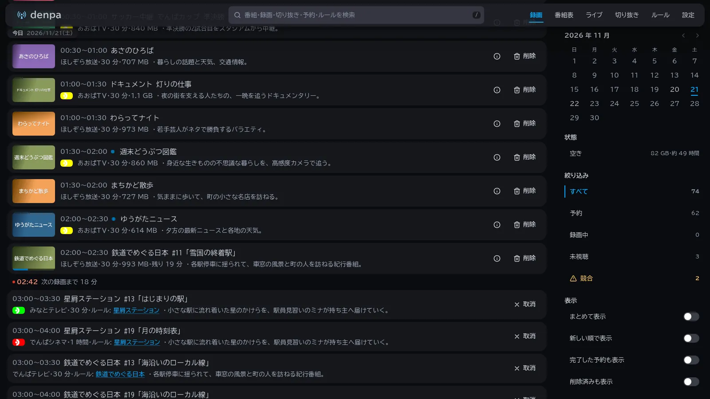
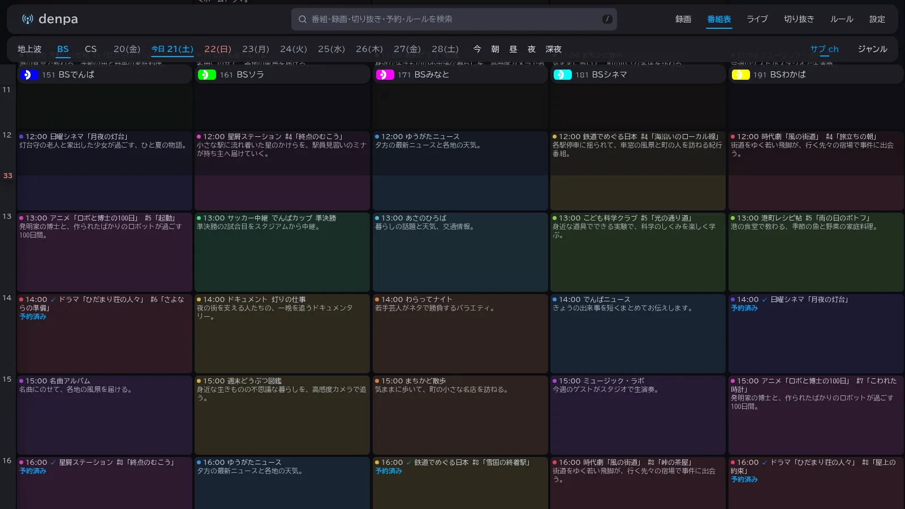
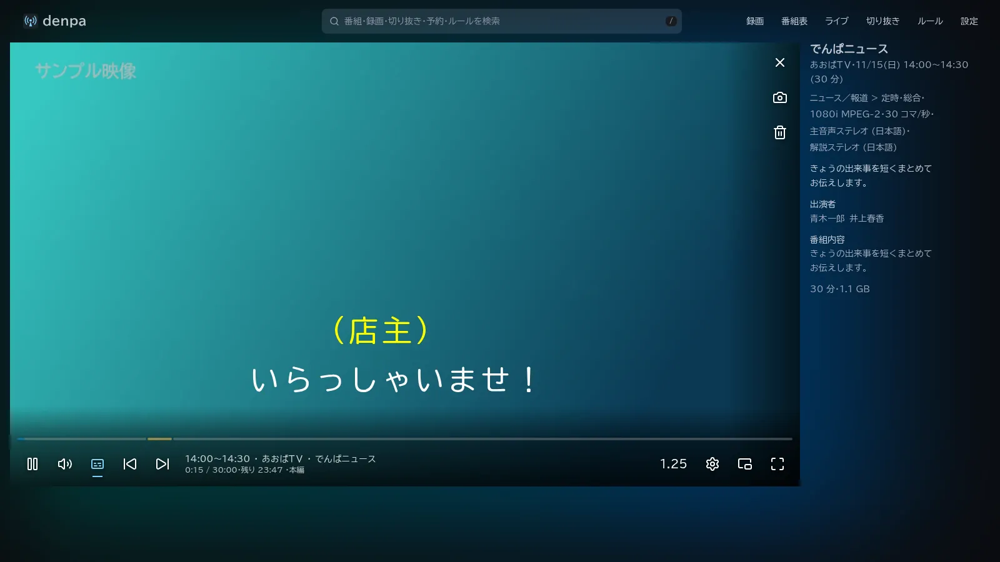
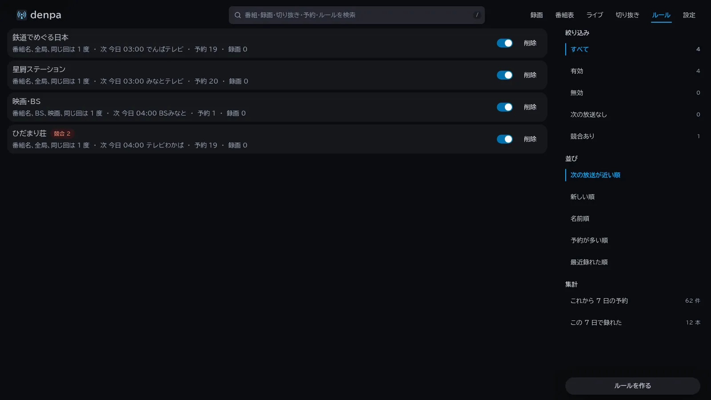

# 画面

偽の放送 (作り物の局・番組・映像) で撮った画像です。撮り直し方は [development.md](development.md#readme-の画像)。

立て方は [install.md](install.md)。

## 録画

予約と録画を**1 本の一覧**に並べます。下へ行くほど時間が進みます。上から録れたもの (古い順)、
いま録っている行、赤い「いま」、これからの予約 (近い順) です。いまより前に始まったものは録画中も含めて「いま」より上に来ます。
「いま」は赤い点と赤い時刻で示し、すぐ後ろに次の録画まで何分かを添えます (線は引きません)。**録画中は「いま」を出さず**、いちばん上の録画中の行の
進み具合のバーの先にいまの時刻を出します (いまは録っている番組の途中なので)。日付ごとに見出しが付き、
一覧の上端に貼り付きます。開いたときは、観終えていない録画があればいちばん古いものを映し
(溜まったぶんを古い順に片付けられるように)、無ければ「いま」を映します。

「新しい順で表示」にすると、並びが上下逆になります (端末ごとに覚えます)。上から予約 (遠い順)、赤い「いま」、録画中、録れたもの (新しい順) です。
日付の見出しは新しい日から並び、録画中は「いま」の下に来ます。開いたときは「いま」を一覧の上端に映し、そのすぐ下に新しい録画が並びます
(観終えていない録画へは送りません)。予約はその上にあり、上へスクロールすると見えます。録画が 1 画面に足りないときは、近い予約も見えます。古い録画は一覧の下へ足していきます。

行は幅いっぱいの 2 段です。1 段目に時刻と番組名、右にボタン。2 段目に局・尺・ルール・番組の説明の冒頭が入ります。
状態は言うことがあるときだけ 3 段目に出します。いま動いていること (録画中・エンコード中・エンコード待ち・端末に保存中) も、
止まっている問題 (競合・失敗・録り逃し・欠ける・映像が欠けた録画・CM の判定・削除済み・取り消し済みなど) も同じ形で、先頭に点か印、状態、
「・」の後ろにあと何分か・進み・理由が続きます (「● 録画中・あと 21 分」「✕ 競合・チューナーが足りません」)。
元の TS の映像が途中で止まった・欠けた録画には「録画が途中で切れています・30 分のうち 19 分」「映像が途中で欠けています・30 分のうち 27 分」と出ます
(測り方は [cm.md](cm.md#映像が途中で切れた録画を一覧で知らせる))。段は 2 つまでで、動いているものが先、
問題は重いものから。収まらないときは 2 段目に残りの状態をつなぎます (理由は詳細で読めます)。
動いているものは下端にバーも敷きます (録画は赤、エンコードは主の色、端末への保存は緑)。ふつうの状態 (予約済み・視聴可能) は出しません。
行は線も枠も無い面に乗り、行の間の余白で 1 本ずつに見えます。触れると行全体の面の色が少し変わります。行の高さはマウスで 64px、指で押す端末では 72px です。

録画の行は左にサムネイル (途中まで観たものは下端に細いバー) が付き、押せばその場で観る画面へ
(録っている最中のものは「いま」のすぐ上にいて、その行の「追っかけ」で追っかけ再生へ。[library.md](library.md#観るのはブラウザで))。
中身を読むときは行の ⓘ から。予約の行を押すと番組の詳細が開きます。
これから録る予約の行には「取消」、取り消した予約の行 (完了した予約も表示のとき。放送が終わるまで) には「戻す」、エンコード中の録画の行には削除の代わりに「エンコード中断」が出ます。

広い画面 (1000px 以上。折り畳み端末のテーブルトップは除く) では、右にサイドバーが出ます (操作の 1 行は出さず、一覧はいちばん上から始まります)。よく使うものほど上で、次の順です。

- 月のカレンダー。行のある日は濃い字で、押すとその日の見出しへ送ります。行の無い日は薄い字で押せません。今日は赤い点、いま一覧の先頭に貼り付いている日は下線です。まとめて表示のときは出ません
- 「状態」にエンコード (進みとあと何分か) と空き (あと何時間録れるかの目安)
- 「絞り込み」はすべて・予約・録画中・未視聴。どれにも件数が付き、選んでいるものは左の縦線と主の色の太字で示します (未視聴は観終えていない録画。途中まで観たものも入ります)。
  続けて、競合・失敗・録り逃し・CM の判定 (ロゴで CM を判定できなかった録画) のうち件数のあるものが、注意の色とアイコンで出ます。押すとそれで絞られ (選んでいる間も字は注意の色のまま)、もう一度押すと戻ります。絞り込みは開き直すと「すべて」に戻ります (予約や録画中を隠したまま開かないように)
- いちばん下の「表示」に、まとめて表示・新しい順で表示・完了した予約も表示・削除済みも表示のスイッチと、ファイルと照合 (→)。完了した予約のうち録画のあるものは録画の行 1 本にまとめ、録画の無いもの (取消など) だけを状態付きで出します

それより狭い画面 (タブレット・スマホ・狭めたウィンドウ) とテーブルトップでは、下のタブのすぐ上に細い 1 行を出します (高さが 600px に満たない画面では、下へスクロールすると隠れ、戻すと出ます)。絞り込みのチップ (1 回押せば絞れ、横に流せます) と、
その後ろに競合・失敗などのうち件数のあるものを注意の色のチップで。右の「⋯」の先頭に状態 (押せません)、その下に表示の切り替えがあります。

768px より狭い画面では、録画の行の詳細と削除は、番組名に幅を回すため右の「⋯」にまとめます。
番組名で探すのは、ホームではなく全体の検索です。
録れたものは新しいほうから 300 件まで出し、300 件に達すると、いちばん古い録画の隣に「新しい順に 300 件まで表示しています。古いものは検索で探してください」と出します。

予約や録画が溜まってきたら、「まとめて表示」で**番組ごと**にまとめられます
(端末ごとに覚えます)。まとめる単位は番組名から決めたシリーズで、エンコード済みの動画を置くフォルダと同じ決め方です (フォルダは録ったときの名前のままなので、あとで分かれることがあります)。
予約にも録画にも効き、同じ番組でも録画は「いま」より上、予約は下と、側ごとに別の見出しになります。録画中の行はまとめずに、録画の側の末尾 (「いま」のすぐ上) にそのまま出ます
(番組の位置は、予約は次の回、録画は最新の回で決まります)。見出しを押すと放送順に開きます。新しい順で表示のときは番組どうしも新しい順に並び、録画中の行は「録画」の先頭 (「いま」のすぐ下) に出ます。番組の中は放送順のままです。
1 本しか無い番組はまとめずにふつうの行のまま出ます。開いた番組の先頭と、録画の詳細には
「ルールを作る」があり、シリーズ名を言葉にして検索の画面の「ルールとして保存」へ行きます
(既にその番組を録っているルールがあれば、作らずにそちらを案内します)。

「詳細」で番組の中身と操作。主のボタン (太字) は「再生」だけで、ほかに「端末に保存」
(オフライン視聴)、「ルールを作る」、切り抜きがあれば「この録画の切り抜き」、「その他…」に視聴済みにする (未視聴に戻す)・再エンコード・CM の再検出 (元の TS のファイルが見つからない録画では、再エンコードを押せず理由を出す)。閉じるのは左下の「閉じる」。640px より狭い画面では下から出る一枚になります。ボタンは全幅にせず、「閉じる」と「再生」を下の段の両端に置き、入りきらないボタンは上の段へ折り返します (中身を読む所を残すため)。
録画をファイルとして持ち出すダウンロードはありません ([library.md](library.md#観るのはブラウザで))。
コマ数 (30/60) もここに出ます。

## 番組表

局ごとの縦の列。マスの時刻の前の点がジャンルの色で、後ろの印と太字の言葉が予約の状態 (予約済み・録画中・競合) です。
放送が過ぎた所はマスが沈み、時の列に「いま」の時刻が出ます。
上の 1 行 (1000px より狭い画面とテーブルトップでは下のタブのすぐ上。高さが 600px に満たない画面では、表を下へスクロールすると隠れ、戻すと出ます) で種別と日付を選び、今・朝・昼・夜・深夜へ送れます。「ジャンル」で色の見本を出し、押すとそのジャンルだけ目立ちます。
サブチャンネルは分割放送のある日だけ本チャンネルの右に並び、そのときは「サブ ch」の切り替えも出ます (切ると本チャンネルだけ。端末ごとに覚えます)。
種別のタブは地上波・BS・CS で、ケーブルの局がある家では「ケーブル」が、番組表に出すスカパー！プレミアムの局があれば「スカパー！プレミアム」が足されます。
マスを押せば詳細が開いてそこから予約・取消。番組を言葉で探すのは[検索](#検索)です。
列の上の局名を押すと、その局でライブが開きます。番組表がまだ無い局 (スキャンしたばかりの局など) も、局名の下が空の列で並び、局名からライブで観られます。
スクランブルを復号できないが番組表は読める局 (ケーブルの 4K の局など。[data.md](data.md#denpa-が持つもの)) は、局名の下に「観られません」と出し、局名はライブへのリンクにしません。
その局の番組の詳細には、予約と視聴のボタンの代わりにわけ (「4K の放送のスクランブル (ACAS) には、まだ対応していないため観られません」など) を出します。検索の結果の行にも予約のボタンを出さず、ルールの下見では「録らない (復号できない局)」になります。
映像の無い局 (ラジオ・データ放送の局。[data.md](data.md#denpa-が持つもの)) もほかの局と同じ列で並び、ライブでは映像が黒いまま音声 (データ放送だけの局は無音) とデータ放送を出します。
手で予約でき、ルールはその局を「局」に選んだものだけが当てます。ほかのルールの下見では「録らない (映像の無い局)」になります。
局の出し方はライブの一覧と同じで、放送を終えた局 (局名が「-」) は出しません。
設定の「チャンネル」で非表示にした局 ([data.md](data.md#局を隠す)) は並びません。その種別の局を全部非表示にすると、表の場所に「地上波の局をすべて非表示にしています」と [チャンネルへ] を出します。
放送が話数を言っている番組は、詳細のジャンルの前に「第 3 話 (全 12 話)」「最終回」「再放送」と出ます ([data.md](data.md#シリーズ記述子の話数と再放送の印))。録画の詳細も同じです。

コピー禁止の番組は録りません ([data.md](data.md#コピー禁止の番組は録らない))。マスと詳細に小さく
「コピー禁止」と出て、予約のボタンは出ません。ルールが当たった予約は「録画しない」になり、
予約の行に「コピー禁止の番組なので録画しません」と出ます。放送が終わっても録り逃しにはせず、「完了した予約も表示」で
理由ごと見られます。ライブの録画ボタンも同じ一文で断ります。
観るのはそのままできます。

BS/CS はロゴをカルーセルから取得して出します ([logo.ts](../src/lib/server/logo.ts))。

## ライブ

放送中のものをそのままブラウザで。映像・音声・字幕・データ放送が入っていて、
局は右の一覧から切り替え。止めれば追っかけ再生になります ([stream.md](stream.md))。
一覧には、番組表がまだ無い局 (スキャンしたばかりの局など) も局名だけで並び、押せば映ります。スクランブルを復号できない局と、設定の「チャンネル」で非表示にした局は並びません。
サブチャンネルは分割放送の間だけ並び、放送を終えた局 (局名が「-」) は並びません。
⚙ の「コーデック」は 自動・エンコードするもの 1 つ・MPEG-2 です。エンコードするものは AV1・H.265・H.264 の順で、サーバがその場でエンコードできて端末で再生できる最初のもの (GPU が無ければ H.264) を並べます。既定の自動は家の中から開くと MPEG-2、外からは AV1 (再生できないか、サーバが GPU で AV1 をエンコードできなければ H.265、それも駄目なら H.264) で流します ([stream.md](stream.md#どの形式で流すか))。行には「自動 (MPEG-2)」のように、いまの形式も出ます。
自動のときは回線に合わせて画質を下げ、行に「自動 (H.264 540p)」のように高さを、映像の上に「回線が細いため、540p に下げました」のような断り書きを出します。回線が戻ると上げ直し、家の中なら MPEG-2 に戻ります。いちばん低い 360p でも足りなければ音声だけにします。形式を選んでいるときは画質を下げず、足りなければ断り書きだけを出します ([stream.md](stream.md#ライブと追っかけの画面))。
形式を切り替えた断り書きは 10 秒で消え、切り替えた先は行に残ります ([stream.md](stream.md#どの形式で流すか))。
1000px より狭い画面では映像を幅いっぱいに出し、局の一覧をその下に並べます (縦長の画面での留め方は [watch.md](watch.md#ライブ))。
折り畳み端末を半分に折って机に置くと、映像を上の段、局の一覧を下の段に出します ([watch.md](watch.md#折り畳み端末を机に置いたとき))。
データ放送は映像の右端の列にある d で開き、開いている間は指で押せるリモコンが一覧の上に出ます。別の局へ移ると、テレビと同じく閉じます。
d を長押しする (マウスは右クリック、キーボードは Shift+D) と、データ放送を自動で受信するかを切り替え、「データ放送を自動で受信します」のように短く出します。オンの間は d の右上に「A」が付きます。
自動で受信する端末では、放送局が自動起動の指定を付けている局に限って、選局したらすぐ受信し、番組が自分で出すもの (天気や誘導の表示など) をテレビと同じく d を押さずに重ねます。指定の無い局は d を押すまで受信しません。リモコンは開いてから出ます ([stream.md](stream.md#自動で受信する端末))。
設定の「連携」の「実況」をオンにした世帯では、⚙ の「実況」でニコニコ実況のコメントを映像の上に流せます ([watch.md](watch.md#実況のコメント))。
⚙ の「実況」もオンにした端末では、局の一覧の最後に「実況」タブが出ます。実況のある局を、種別をまたいで勢い (1 分あたりのコメント数) の大きい順に並べ、2 段目の先頭に「勢い 412」と出します。
数字は 30 秒ごとに書き換わり、そのたびに勢いの順に並べ直します (行は前の場所から滑ります。動きを減らす設定ではその場で置き換えます)。一覧に指やポインタが乗っている間とキーボードで選んでいる間は並べ直さず、離れて 1 秒たってから並べ直します (押そうとした行が動いて別の局を選ばないように)。勢いを読めないときは番号順で並べ、一覧の先頭に「いまは勢いを読めません」と出します。
種別のタブは局のある種別だけ (地上波・BS・CS・ケーブル) で、番号順のままで数は付けません。
ライブを開いたときのタブは、「実況」タブが出ている (実況を流している) 端末では「実況」、ほかはいま映している局の種別です。タブを押して選んだら、ページを離れるまでそのタブのままです (覚えはしません)。
流している間は、映像の右端の列にある「コメントの一覧」を押すと、右の列の先頭 (データ放送のリモコンと同じ所。局の一覧はその下に残ります) に流れているコメントを新しいものが下になるように並べ、見出しの横に勢いを出します ([watch.md](watch.md#コメントの一覧))。
一覧の下には実況に書き込む 1 行が付きます (ニコニコと連携している世帯では公式のニコニコ実況へ、ほかは NX-Jikkyo へ)。書けるのは「いま」に追い付いているときだけで、色・位置・大きさは入力欄の右のパレットのボタンで選びます。一覧を出せない横にしたスマホと全画面では、同じボタンで操作バーのすぐ上に 1 行を開きます ([watch.md](watch.md#実況に書き込む))。

## 録画を観る

エンコード済みの録画をブラウザで (エンコード前・エンコードに失敗したものは、サーバがその場で変換して流します。家の中の「自動」と MPEG-2 を選んだときは、元の TS を端末がデコードして描きます)。字幕は放送どおりの位置に重ね、CM は自動で飛ばします (1 コマも見せません)。
シークバーの CM のところは琥珀色で分けます (denpa-tv と同じ色)。
コーデックが「自動」なら、回線が細いときは画質を 720p・540p・360p・音声だけと下げ (互換モードは 360p で止めます)、⚙ のコーデックの行に「自動 (H.264 540p)」のように出します ([watch.md](watch.md#回線が細いと画質を下げます-観る画面))。
右は番組の中身と、切り抜きがあれば「この録画の切り抜き (3)」。下の操作バーに再生・音・字幕・チャプター送り・時刻・速さ (互換モードと MPEG-2 では速さを出しません)、映像の右端に縦に閉じる・切り抜き・削除。端末のコピーで観ているときは、操作バーの放送時刻の前に「端末」と出ます。データ放送は「⚙」(再生の設定) の「データ放送」から出します。その行を長押しする (マウスは右クリック、キーボードは Shift+D) と、ライブと同じく自動で受信するかを切り替え、オンの間は行に「(自動で受信)」と出ます。自動で受信する端末では、自動起動の指定がある録画に限って、開く前から番組が自分で出すものを重ねます (リモコンは開いてから)。
折り畳み端末を半分に折って机に置くと、番組の中身は映像の下の段に出ます。
実況を流している間は、映像の右端の列の「コメントの一覧」で、番組の中身の上にコメントを並べられます (時刻は録画の中の再生位置で、押すとその場面へ飛びます)。

操作バーはライブ・追っかけと同じ作りで、ボタンはいつも 1 行に並べます。スマホの縦のように幅が足りないときは、
よく使うもの (観る画面は再生・チャプター送り・時刻・⚙・全画面、ライブと追っかけは再生・ライブ/最新・⚙・全画面) だけを残し、
音・速さ・小窓 (ライブは Hybridcast も) は「⚙」(再生の設定) の先頭に行として入ります (字幕は「⚙」の「字幕」から。「⋯」のボタンはありません)。
端末ごとに決めておくもの (CM スキップ・アンビエントモードなど) は、幅にかかわらず「⚙」に入っています ([watch.md](watch.md#操作バー))。
iPhone と iPad では、3 画面とも音量のつまみを出さず、本体の音量ボタンで音量を変えます (音のボタンは消音だけ。[watch.md](watch.md#音量))。
時刻も「0:31 / 1:00:00」だけの短い形にします。
操作バーは触らなければ引っ込み、画質やコーデックを自動で切り替えても出てきません (切り替えたことは映像の上の断り書きで知らせます)。

## 切り抜き

観る画面・追っかけ・ライブの切り抜きのボタン (カメラ) を押すと、その 1 コマ (出している字幕・実況のコメントごと) をサーバに保存します。ボタンが一瞬チェックになり、
「保存しました」の 1 行が出ます (PC はクリップボードにもコピーします)。オフラインで観ているときやサーバが断ったときだけ、端末に保存します。

`/clips` には撮った日の見出しの下に 1 枚ずつ並びます。広い画面ではヘッダーの「切り抜き」から開き、右のサイドバーで
撮った日 (カレンダー)・ライブか録画か・局で絞れ、使っている量も出ます。スマホでは下のタブのすぐ上の「絞り込み」から、ライブか録画か・局で絞ります (撮った日のカレンダーはありません)。メニューの最後に「12 枚・3.4 MB」のように枚数と使っている量が出て、撮った日で絞っているときは「<日付> の絞り込みを外す」も出ます。
言葉 (番組名・局名・字幕) で探すのはヘッダーの検索で、結果の「切り抜き」の「切り抜きの画面で見る」から同じ言葉のまま入れます
(一覧の上に探した言葉が出て、「絞り込みを外す」ですべてに戻ります)。録画の詳細・観る画面の「この録画の切り抜き」からも入れます。

1 枚を押すと一覧の上に浮かぶ箱で開き (後ろの暗い幕を押すと閉じる)、右端に縦に閉じる・この場面から観る (録画のその位置から再生)・字幕・コメント・クリップボードにコピー・端末に保存・削除 (2 回押し) が並びます。
「字幕」「コメント」は撮ったときに出していたものだけに出て、押すとすぐ重ねる・外すが切り替わります (一覧の画像と端末に保存する画像はサーバが作り直します。
最初は撮ったときのまま重なっています)。
「クリップボードにコピー」は、いま重ねているとおりの 1 枚を PNG でコピーします (コピーできるとボタンが一瞬チェックになります)。画像をコピーできないブラウザでは出ません。
何枚かまとめて消すときは、写真のアプリと同じく選びます。マウスでは 1 枚に乗せると左上に丸が出て、押すと選び始めます。
スマホ・タブレットは 1 枚を長押しします。選んでいる間は 1 枚を押すと選ぶ・外すになり (開きません)、Shift を押しながら押すと前に押した 1 枚までをまとめて選べます。
「3 枚を選択中」のような 1 行 (広い画面ではヘッダーの下に貼り付きます) の「削除」(2 回押し) で消し、「選択を終了」か Esc で抜けます。録画を消しても切り抜きは残ります (「この場面から観る」が出なくなるだけ)。

## ルール

自動予約のルールの一覧と管理です。ルールは録画の一覧と同じ 2 段の行で並び、1 段目に名前とスイッチ・削除、
2 段目に条件 (探す所・局・ジャンル・時間帯と曜日・同じ回は 1 度・前の回は録らない・除外)・次の放送・予約と録画の数・最後に録れた日が出ます。
広い画面では右のサイドバーで「すべて / 有効 / 無効 / 次の放送なし / 競合あり」の絞り込み (件数つき)・並び・集計 (これから 7 日の予約、この 7 日で録れた本数) を選べます。
それより狭い画面とテーブルトップでは、絞り込みと並びは下のタブのすぐ上の細い 1 行にまとまり (高さが 600px に満たない画面では、下へスクロールすると隠れ、戻すと出ます)、集計は一覧の上の 1 行に出ます。640px より狭い画面では、2 段目は次の放送と予約・録画の数だけです。

有効/無効は行のスイッチで開かずに切り替えられ、削除は 2 回押しです (1 回目で「削除を確定」に変わります)。
行を押すと、[検索](#ルールとして保存)の画面でそのルールを直せます。ルールを作るのも検索の画面の「ルールとして保存」からです (サイドバーの「ルールを作る」、スマホの形では下の「作る」で開きます)。

局のサービス ID が変わって (局の統合・終了と別の局の開始) 選局できなくなった局を指すルールがあると、一覧の上に出ます。
同じチャンネルの局や同じ名前の局を候補に並べるので、選んで「付け替え」を押すと、その局の番組を録画します。自動では付け替えません (間違えると別の局を録るため)。候補が無いルールは出ません (行を押して検索の画面で局を選び直します)。

「同じ回は最初の放送だけ」(新しく作るルールは入った状態で始まります) を入れておくと、
`[新]` のようなゆるい条件で当たっても、局を替えた再放送や同時放送は録りません。
同じ時刻に流れているなら字幕のあるもの、次に BS/CS を選びます。

「前の回は録らない」(ふだんは切ってあります) を入れておくと、途中の回から追っているシリーズで、
録ったか予約した回より前の話数の放送 (4 話のあとに来た 1〜3 話の一挙放送など) は録りません。
番組名が同じまま 1 話から数え直すシリーズでは使わないでください。二期 (`第2期`) は別のシリーズとして録ります。

## 検索

番組表・録画・切り抜き・予約・ルールを 1 つの言葉でまとめて探します。広い画面ではヘッダーの真ん中の欄から
(どこからでも `/` か Ctrl+K (Mac は ⌘+K) で入れます。入力欄で字を打っている間は効きません)、
1000px より狭い画面では下のタブの「検索」から (画面の上に同じ欄が出て、欄に入った状態で開きます)。
打つそばから欄の下に候補が出ます (節ごとに数件。↑/↓ で選んで Enter で開き、何も選ばずに Enter ならすべての結果、Esc で閉じます)。
結果の画面にも同じ欄がそのままあり、打つそばから結果が変わります (Enter は要りません)。
結果の URL (`/search?q=…`) はそのまま人に渡せます。

結果は「これからの放送」「録画」「録画の字幕」「切り抜き」「予約」「ルール」に分かれ、それぞれ件数と先頭の 5 件を出します (残りは「もっと見る」。切り抜きは数枚の画像だけで、続きは「切り抜きの画面で見る」)。
読み方はどれも同じで、空白で区切った語をすべて含むものが当たります (全角/半角・大文字/小文字は区別しません)。

- 「これからの放送」は、番組名と概要に当たる、まだ終わっていない番組。行から予約・取消。行を押すと番組の詳細 (「ルールを作る」はその番組のシリーズ名で右の書く欄を始めます)。
  右の書く欄の条件で録るかどうかを行ごとに出します (下の「ルールとして保存」)
- 「録画」は、番組名・シリーズ・副題・局名に当たる録画。押せば観る画面へ (録っている最中のものは追っかけ再生へ)。削除もここから
- 「録画の字幕」は、字幕に当たる録画 ([library.md](library.md#字幕で探す))。1 件は録画 1 本で、当たった場面を時刻の順に 3 か所まで、前後の字幕の 1 枚を添えて出します (当たった所に下線)。
  時刻は番組の始めからで、場面を押すとその場面から、録画の名前を押すと初めから観る画面を開きます。10 秒より近い当たりは 1 つにまとめ、4 か所以上あれば「この録画で 12 か所」と出します。
  字幕を読み終えていない録画があれば「字幕を探せるようにしています (あと 123 本)」と出し、言葉がどれも 1 文字なら「字幕は 2 文字から探します」と出します。
  件数は 100 本まで数え、それより多ければ「100+」です
- 「切り抜き」は、番組名・局名・字幕に当たる切り抜き。押せば同じ言葉のまま切り抜きの画面へ
- 「予約」は、これから録るものといま録っているもの。押せば詳細、取消もここから (録っている最中のものは取消の代わりに「追っかけ」)
- 「ルール」は、名前・キーワード・除外する言葉に当たるルール。押せば右の書く欄でそのルールを直せます

行の「取消」は、これから録る予約 (予約済み・競合) にだけ出ます。録画中の予約と、録画しない予約 (コピー禁止・同じ回を録画済み) は、詳細の「予約取消」から取り消します。
詳細のボタンは番組表の詳細と同じです (録れた番組の「再生」は出さず、「録画」から観ます)。詳細から予約・取消をして断られたときは理由を詳細の中に、行のボタンのときは右下の通知に出します。

言葉なしで開くと、その端末で最近探した言葉が並びます (サーバには送りません)。

設定の「連携」の「番組ランキング」に参加していれば、その下に節「人気の番組」が出ます。
ほかの家と合わせた順位 (予約した家とライブで観た家の数) で、これから・放送中・終わって 24 時間以内の番組を混ぜて数の多い順に並べ、先頭の 5 件を出し、「もっと見る」でその場に 50 件まで広げます。

- 行は「これからの放送」と同じで、押すと番組の詳細。1 段目の先頭に順位、2 段目の最後に「約 120 世帯」を出します (数は 5 の倍数に切り下げた目安)
- 2 段目の先頭に、放送中の番組は「放送中」、終わった番組は「放送済み」と出します。行のボタンは、これからの番組は予約・取消、放送中の番組は「視聴」(その局のライブ。観られない局なら出さない)、終わった番組は録画があれば「再生」です
- 受信できない局の番組も出します。ボタンは出さず、押しても詳細は開きません (手元の番組表に無いため)。2 段目の先頭に「受信できない局」と出し、続けて局名と、分かれば地域を出します。系列のある地上波の番組は、局名の代わりに系列とほかの地域の数を出します (「TBS 系・関東広域ほか 12 地域」)。地域をまたいでまとめた番組は、受信できる局の放送があればその局の行にします
- 順位は denpa-hub が付けたままで、受信できない番組を飛ばして振り直しません。どの放送も終わって 24 時間を過ぎていて手元に無い番組は出しません
- サーバが denpa-hub から受け取った順位を 10 分ためておきます。hub を待つ間は「読み込んでいます…」、受け取れなければ「いまはランキングを読めません」、順位が空なら「当てはまるものはありません」と出します

参加するかをまだ決めていない家では、同じ場所に節「人気の番組」として参加の案内を出します。「番組ランキングに参加すると、ここに人気の番組が並びます」の下に、
設定の説明の 1 行目と同じ同意の文と「詳しく」(設定の「連携」の「番組ランキング」へ)、その下に「参加」「参加しない」が並びます。

- 「参加」は設定のスイッチをオンにしたときと同じで、サーバが denpa-hub からトークンを受け取り、すぐ 1 回目を送ります。参加できれば案内の代わりに順位の節が出ます。受け取れなければ理由を右下の通知に出し、案内は出したままにします
- 「参加しない」を押すと、何も送らずに「番組ランキングに参加しません。設定の「連携」で変えられます」と出し、案内を消します
- どちらを選んでも世帯の設定として残すので、ほかの端末にも二度と出しません。設定のスイッチで参加した家・オフにした家にも出しません
- 案内を出す前のバージョンでオフだった家は、既定のオフのままの家と自分でオフにした家を見分けられないので、どちらにも一度出します
- アクセストークン (テレビのアプリ) には出しません。参加するかは世帯の同意なので、ブラウザから決めます ([auth.md](auth.md))

### ルールとして保存

探した言葉から、その場で自動予約のルールを作ります。広い画面 (1000px から。テーブルトップは除く) では結果の右の列、それより狭い画面とテーブルトップでは下の「ルールとして保存」から下に出ます。下から出したときは、下の段の左に「閉じる」、右端に保存のボタンが並びます。
キーワード (探した言葉から始まります)・探す所 (番組名/概要/詳細)・除外する言葉の下に、同じ回は最初の放送だけ・前の回は録らないのスイッチ、
その下に条件の行 (局・ジャンル・時間帯と曜日)、最後に優先度が並びます。スイッチが上なのは、同じ回を最初の放送だけにすれば局を絞らずに済むためです。
条件の行はたたんであり、閉じていても右に中身が出ます (「全局」「すべて」「いつでも」「金 19:00〜20:00」など)。ジャンルと時間帯はふだんはそのままで構いません。

時間帯と曜日は**番組の始まる時刻**で見ます (日本時間)。時間帯は「から」の時刻ちょうどを含み、「まで」の時刻ちょうどは含みません。
「まで」が「から」より前なら日をまたぎます (23:00〜02:00)。そのときも曜日は始まる日で見るので、「金 23:00〜02:00」は金曜の 23 時台と、
金曜の 0〜2 時に始まる番組です (土曜の 1 時は入りません)。始まりと終わりが同じ時間帯は保存できません。曜日はいくつでも選べます (日曜から並びます)。
時間帯と曜日は絞り込みなので、キーワード・局・ジャンルのどれかと一緒に使います (それだけでは保存できません)。

条件を変えると、結果の「これからの放送」の行ごとに **録る** / **録らない** (同じ回・前の回・除外・局・時間帯の外・取り消し済み・本チャンネルと同じ番組などの理由つき。薄く出ます) / 予約済み がすぐ変わります。
判定は予約を立てるときと同じものです。取り消した予約の回は、ルールを保存した時刻と取り消した時刻の新しいほうで決まります。
新しいルールは取り消した回も「録る」で、保存するとルールの予約として作り直します。保存してあるルールより後に取り消した回は「録らない (取り消し済み・保存すると録る)」で、
保存し直すと作り直します。手動予約の回も、あとから保存したルールの予約に切り替わります ([data.md](data.md#人の決定とルールは後勝ち))。下の「N 件を録るルールを保存」で保存し、保存したルールへのリンクが出ます。

ルールを直すときは `/search?rule=<ID>` で開きます (ルールの一覧の行や、検索の「ルール」から)。「編集中: <名前>」と出て、
「更新」・「有効」のスイッチ・「削除」(2 回押し) が並びます。言葉なしで開くと、結果の代わりにそのルールで録る番組が並びます (行を押すと番組の詳細、取り消せる予約の行は「取消」、録る行は「予約」でその 1 本だけ扱えます)。URL はそのまま渡せて、戻るでも戻れます。

## 設定

左にグループとその節の一覧、右にグループの画面が並びます。グループごとに 1 つの画面 (`/settings/<グループ>`) で、節は上から積んであります。
一覧の節を押すとその節まで滑らかにスクロールし (`/settings/<グループ>#<節>`)、スクロールしていくと見えている節に一覧で印 (左の縦線と主の色の太字) が付きます。戻る・進むもそのまま使えます。
768px より狭い画面では一覧 (グループだけ) が先に出て、押すとその画面に切り替わります。設定へ戻る ← と節の名前の行が下のタブのすぐ上に付いています (高さが 600px に満たない画面では、下へスクロールすると隠れ、戻すと出ます)。見えている節にボタンや絞り込みがあれば (チャンネルのスキャン、ログの絞り込みと「Issue にする」)、1000px より狭い画面ではそれを下に浮かべた 1 行に出し (768px からは左の一覧が残るので、下のタブのすぐ上)、節を移ると入れ替わります。広い画面で「設定」を開くと、先頭の「録画」が開きます。

| グループ              | 節                                    | 中身                                                                                                                                                                                                                                                                                                                                                                                                                                                                                                                                                                                                                                                                                                                                                                                                                                                                                                                                                                                                                                                                                                                                                                                                                                                                                                                                                                                                                                                                                                                                                                                                                                                                                                                                                                                                                                                                                                                                                                                                                                                                                                                                                                                                                                                                                 |
| --------------------- | ------------------------------------- | ------------------------------------------------------------------------------------------------------------------------------------------------------------------------------------------------------------------------------------------------------------------------------------------------------------------------------------------------------------------------------------------------------------------------------------------------------------------------------------------------------------------------------------------------------------------------------------------------------------------------------------------------------------------------------------------------------------------------------------------------------------------------------------------------------------------------------------------------------------------------------------------------------------------------------------------------------------------------------------------------------------------------------------------------------------------------------------------------------------------------------------------------------------------------------------------------------------------------------------------------------------------------------------------------------------------------------------------------------------------------------------------------------------------------------------------------------------------------------------------------------------------------------------------------------------------------------------------------------------------------------------------------------------------------------------------------------------------------------------------------------------------------------------------------------------------------------------------------------------------------------------------------------------------------------------------------------------------------------------------------------------------------------------------------------------------------------------------------------------------------------------------------------------------------------------------------------------------------------------------------------------------------------------ |
| 録画 (`recording`)    | エンコード (`encoding`)               | コーデックとそのエンコーダ (ソフトウェア・GPU。「録画」と「ライブ」の 2 列で別々に選ぶ)・同時に変換する本数・元の TS を残すか                                                                                                                                                                                                                                                                                                                                                                                                                                                                                                                                                                                                                                                                                                                                                                                                                                                                                                                                                                                                                                                                                                                                                                                                                                                                                                                                                                                                                                                                                                                                                                                                                                                                                                                                                                                                                                                                                                                                                                                                                                                                                                                                                        |
|                       | 視聴 (`viewing`)                      | 家の中の名前 (1 行に 1 つ。この名前で開くとライブの自動が MPEG-2 を先に選ぶ。家の中の IP・localhost・.local・.lan・.home.arpa・.internal は書かなくても家の中)                                                                                                                                                                                                                                                                                                                                                                                                                                                                                                                                                                                                                                                                                                                                                                                                                                                                                                                                                                                                                                                                                                                                                                                                                                                                                                                                                                                                                                                                                                                                                                                                                                                                                                                                                                                                                                                                                                                                                                                                                                                                                                                       |
| 受信 (`reception`)    | エージェント (`agents`)               | 1 台 1 件の一覧。1 段目は名前、2 段目はホスト・チューナーの台数・バージョン・状態 (環境変数で決めたものは「環境変数」、3 分を超えて繋がらなければ「繋がりません (<時刻> から)」)。証明書が変わったときと「エージェントにこの denpa の登録がありません」のときは、その下にエラーの色で 1 行出し、右端に「URL を変える」を出す。バージョンが違う・元の TS の置き場が見えないときは、⚠ と注意の色で 1 行ずつ。右端の「⋯」で名前を変える・URL を変える (変えると「「<名前>」の URL を変えました」)・削除 (2 回目は「削除を確定」。そのエージェントで録画中なら、番組名と、削除したあとに録画が途切れても取り直さないことを出す)。環境変数で決めたものは「⋯」に「TUNER_AGENT_URL から消すと外れます」を出し、URL の変更と削除は無い。一覧の下の「エージェントを追加」で、登録用の URL を貼るダイアログを開く (カメラを使える画面なら「QR を読む」も)。LAN で見つかった未登録のエージェントは入力欄の下に名前とアドレスで並び、選ぶと `https://<アドレス>:<ポート>#pair=` を入力欄に入れる (合言葉は足すか、登録用の URL を貼る)。1 台も無ければ「エージェントがありません」                                                                                                                                                                                                                                                                                                                                                                                                                                                                                                                                                                                                                                                                                                                                                                                                                                                                                                                                                                                                                                                                                                                                                                                                               |
|                       | チューナー (`tuners`)                 | エージェントごとに、名前を控えた字の見出しにして (1 台でも出す) 1 台 1 行の表 (受信できる種別・空きと使っている相手・使用中なら受信の状態・C/N・強度 (dBm で測れる機材だけ)・「使う」のスイッチ。名前・デバイス・LNB と削除は「⋯」) とカードリーダー (リーダーごとの「使う」のスイッチと、局ごとの契約と復号を確かめる「有料契約を確認」)。繋がらないエージェントは見出しの下に「繋がりません」の 1 行だけ。機材が受けられない種別は選べず、ケーブルとスカパー！プレミアムは受けられる機材があるときだけ出る。**うまくいかないときはまずここ**                                                                                                                                                                                                                                                                                                                                                                                                                                                                                                                                                                                                                                                                                                                                                                                                                                                                                                                                                                                                                                                                                                                                                                                                                                                                                                                                                                                                                                                                                                                                                                                                                                                                                                                                       |
|                       | チャンネル (`channels`)               | 受信できるチャンネルと番組表の集まり具合。1 行に 1 局で、受信できないと分かったチャンネルには「受信できません」、まだ確かめていない BS・CS のチャンネルには「確認中」とチャンネル名の下に出す。エージェントが 2 台以上なら、その前にエージェントの名前を添え (「書斎: 受信できません」)、受けられるエージェントの名前も並べる (「居間・書斎」)。ケーブルの局のうち地上波・BS・CS を再送信しているチャンネルには、元の放送 (「BS の再送信」「BS4K の再送信」など) をチャンネル名の下に出す。スクランブルを復号できない局 (スカパー！プレミアムの局と、B-CAS 以外の方式でスクランブルされたケーブルの局と、ACAS でスクランブルされたケーブルの 4K の局) は局名の後ろに「復号できません」と出し、ライブと録画に使えないわけと、番組表を読める局は番組表に「観られません」の列で出すことを表の上に出す。ケーブルとスカパー！プレミアムのチャンネルは、最後のスキャンで分かったこと (CA_system_id と番組表・ロゴが来ているか) をそのチャンネルの下に出す。局名の後ろの「非表示」で、その局を番組表・ライブ・検索・ルールの局の選択・テレビのアプリから外す (世帯で 1 つ。サブチャンネルは本チャンネルと一緒に外れ、サブの行にはボタンを出さない。戻せる操作なので 2 回押しにしない)。非表示の局は局名を薄くして「非表示」と出し、ボタンは「再表示」になる。表の上の数の行に「非表示 n 局」を添える ([data.md](data.md#局を隠す))。局ロゴと CM 検出のために覚えたロゴ (CM ロゴ) の列もここ (押すと大きく見られ、「覚え直す」はそのダイアログの中。狭い画面ではロゴを局名の前に出す)。チャンネル名の下の「測定」を押すと、そのチャンネルを 5 秒ほど受信し、誤り・ドロップ・受信した速さと受信の状態・C/N を行の下に出す ([tuners.md](tuners.md#信号レベル))。チャンネルスキャン (種別を選んで「スキャン」。回っている間は「中断」。エージェントが 2 台以上なら、スキャンと局の削除の対象をエージェントのチップで選び (既定は全部)、進み具合もエージェントごとに出す。ケーブルとスカパー！プレミアムは、受信できる種別にそれを選んだチューナーがあるときだけ選べる)。局の削除 (局がある種別を選んで「局を削除」。2 回目は「削除を確定」。チューナーの有無によらず、その種別のチャンネルと局を消せる。録画は残り、スキャンし直せば戻る。スキャンの実行中は出さない)・「番組表をいますぐ集める」・「ロゴをいますぐ集める」は見出しの行にあります。前の「ロゴ」の節 (`#logos`) はここへ送ります |
|                       | データ放送 (`broadcast`)              | 郵便番号と都道府県・双方向                                                                                                                                                                                                                                                                                                                                                                                                                                                                                                                                                                                                                                                                                                                                                                                                                                                                                                                                                                                                                                                                                                                                                                                                                                                                                                                                                                                                                                                                                                                                                                                                                                                                                                                                                                                                                                                                                                                                                                                                                                                                                                                                                                                                                                                           |
| 連携 (`integrations`) | 通知 (`notifications`)                | 通知先 (Webhook)                                                                                                                                                                                                                                                                                                                                                                                                                                                                                                                                                                                                                                                                                                                                                                                                                                                                                                                                                                                                                                                                                                                                                                                                                                                                                                                                                                                                                                                                                                                                                                                                                                                                                                                                                                                                                                                                                                                                                                                                                                                                                                                                                                                                                                                                     |
|                       | テレビのアプリ (`tv`)                 | ペアリングしたテレビ。取消は 2 回押し                                                                                                                                                                                                                                                                                                                                                                                                                                                                                                                                                                                                                                                                                                                                                                                                                                                                                                                                                                                                                                                                                                                                                                                                                                                                                                                                                                                                                                                                                                                                                                                                                                                                                                                                                                                                                                                                                                                                                                                                                                                                                                                                                                                                                                                |
|                       | 実況 (`jikkyo`)                       | ニコニコ実況のコメントを流せるようにするか (世帯の設定。既定はオフ)。オンにすると端末の ⚙ に「実況」の行が出る。ライブで実況に書き込めるようにもなる (ニコニコと連携していれば公式のニコニコ実況、ほかは NX-Jikkyo。書いたものは公開され、消せない)。NG ワード (1 行 1 語。含むコメントは流さない) と、ニコニコのアカウントとの連携 (「ニコニコと連携」・「連携を解除」。解除は 2 回押し。世帯で 1 つ) もここ。説明の 1 行目に、端末が外のサービス (NX-Jikkyo・過去ログ API) に直接繋ぎ、相手に端末の IP とどの局をいつ観ているかが見えることを出す                                                                                                                                                                                                                                                                                                                                                                                                                                                                                                                                                                                                                                                                                                                                                                                                                                                                                                                                                                                                                                                                                                                                                                                                                                                                                                                                                                                                                                                                                                                                                                                                                                                                                                                                  |
|                       | 番組ランキング (`ranking`)            | 番組ランキングに参加するか (世帯の設定。既定はオフ)。オンにするとサーバが denpa-hub からトークンを受け取り、すぐ 1 回目を送る。受け取れなければオフに戻して理由を出す。オンの間は「最後に送った時刻: 11/17(火) 18:12」を出し、送れなかったときは「denpa-hub に届きませんでした。次の送信で再試行します」(hub が受け付けを止めていれば「denpa-hub が番組ランキングを受け付けていません。次の送信で再試行します」) を出す。オフにすると送ったものを取り消してからトークンを消す。説明の 1 行目に、予約した番組・録画した番組・観た番組を denpa-hub に送ること、家を特定できない集計の数を外部 (放送局など) に示すことがあること、名前や住所は送らないことを出す (同意の文) ([architecture.md](architecture.md#番組ランキング-denpa-hub))。順位は検索を言葉なしで開いたときの節「人気の番組」に出す。参加するかをまだ決めていない家には、同じ場所に参加の案内を出す ([検索](#検索))                                                                                                                                                                                                                                                                                                                                                                                                                                                                                                                                                                                                                                                                                                                                                                                                                                                                                                                                                                                                                                                                                                                                                                                                                                                                                                                                                                                                     |
|                       | EPGStation からの引き継ぎ (`migrate`) | EPGStation の URL を入れて、ルール・手動予約・録画と録画の履歴を取り込む (URL は保存しない。下見だけもできる。中断したものは続きから)                                                                                                                                                                                                                                                                                                                                                                                                                                                                                                                                                                                                                                                                                                                                                                                                                                                                                                                                                                                                                                                                                                                                                                                                                                                                                                                                                                                                                                                                                                                                                                                                                                                                                                                                                                                                                                                                                                                                                                                                                                                                                                                                                |
|                       | EDCB からの引き継ぎ (`migrate-edcb`)  | EpgTimerSrv に TCP で繋いで、ルール・手動予約・録画の履歴の取り込み (宛先は保存しない。録画のファイルは取り込まない)                                                                                                                                                                                                                                                                                                                                                                                                                                                                                                                                                                                                                                                                                                                                                                                                                                                                                                                                                                                                                                                                                                                                                                                                                                                                                                                                                                                                                                                                                                                                                                                                                                                                                                                                                                                                                                                                                                                                                                                                                                                                                                                                                                 |
|                       | 録画ファイルの取り込み (`ts-import`)  | ほかのソフトで録った TS (`.ts`・`.m2ts`) を、元の場所に置いたまま録画に加える。サーバから見たフォルダ (`IMPORT_DIRS` の下) を入れ、下見だけもできる。取り込み済みと同じ番組の録画があるものは飛ばす。中断したものは続きから。`IMPORT_DIRS` が空なら使い方だけを出す                                                                                                                                                                                                                                                                                                                                                                                                                                                                                                                                                                                                                                                                                                                                                                                                                                                                                                                                                                                                                                                                                                                                                                                                                                                                                                                                                                                                                                                                                                                                                                                                                                                                                                                                                                                                                                                                                                                                                                                                                  |
|                       | denpa を別の機械へ移す (`transfer`)   | ルール・予約・録画の一覧・設定・局ロゴを書き出す。まだ使っていない denpa なら、書き出したファイルを送って確かめ、取り込む (録画のファイルは入らない。置き場に無い録画があれば止まる)                                                                                                                                                                                                                                                                                                                                                                                                                                                                                                                                                                                                                                                                                                                                                                                                                                                                                                                                                                                                                                                                                                                                                                                                                                                                                                                                                                                                                                                                                                                                                                                                                                                                                                                                                                                                                                                                                                                                                                                                                                                                                                 |
| その他 (`general`)    | この端末 (`browser`)                  | テーマ (端末に合わせる・ライト・ダーク)・季節の演出 (世帯で 1 つ。既定はオン。[下](#季節の演出))・画面の高さを見る・ライブのチューナー (開発者向け。ライブで使うチューナーを名指しする。エージェントの名前の見出しで分ける)。テーマ・画面の高さを見る・ライブのチューナーは端末ごと。ロゴを集めた結果を記録する (開発者向け。世帯で 1 つ。[logo.md](logo.md#ロゴの取得を記録する))。互換モードは再生画面の ⚙ で切り替えるので、ここには置きません                                                                                                                                                                                                                                                                                                                                                                                                                                                                                                                                                                                                                                                                                                                                                                                                                                                                                                                                                                                                                                                                                                                                                                                                                                                                                                                                                                                                                                                                                                                                                                                                                                                                                                                                                                                                                                    |
|                       | ログイン (`login`)                    | ログアウト・ほかの端末からもログアウト (ログインして使っているときだけ。素通しではその旨の 1 行)                                                                                                                                                                                                                                                                                                                                                                                                                                                                                                                                                                                                                                                                                                                                                                                                                                                                                                                                                                                                                                                                                                                                                                                                                                                                                                                                                                                                                                                                                                                                                                                                                                                                                                                                                                                                                                                                                                                                                                                                                                                                                                                                                                                     |
|                       | バージョンと環境 (`version`)          | denpa とエージェントのバージョン (エージェントは名前を付けて 1 台ずつ。違えば知らせる)・サーバとエージェントの OS・サーバの CPU (型番とコア数) と GPU (デバイスごとにエンコードできるもの)・Windows と Mac のサーバならスリープからの復帰 (録画の前に起こす時刻。起こせなければ理由)・macOS のエージェントなら CCID ドライバ・チューナー・カードリーダー・端末 (UA から読んだブラウザと OS・画面とウィンドウの大きさ・倍率・指で操作するか)・ブラウザ (UA)。新しいバージョンが出ていれば denpa のバージョンの下にリンクが出て、下のタブ (640px 未満は「その他」) とヘッダーの「設定」、左の一覧の「その他」に点が付きます (広い画面はヘッダーにもリンク)                                                                                                                                                                                                                                                                                                                                                                                                                                                                                                                                                                                                                                                                                                                                                                                                                                                                                                                                                                                                                                                                                                                                                                                                                                                                                                                                                                                                                                                                                                                                                                                                                             |
|                       | ログ (`logs`)                         | サーバとエージェントのログ (新しい順。それぞれ最後の 2000 行)。「サーバ」と各エージェントの名前のチップ、「警告とエラーだけ」、検索で絞る。「再読み込み」で取得し直す。「Issue にする」でバグ報告を作る ([下](#バグの報告))                                                                                                                                                                                                                                                                                                                                                                                                                                                                                                                                                                                                                                                                                                                                                                                                                                                                                                                                                                                                                                                                                                                                                                                                                                                                                                                                                                                                                                                                                                                                                                                                                                                                                                                                                                                                                                                                                                                                                                                                                                                          |

説明は要点 1 行で、続きは「詳しく」にたたんであります。前の節ごとの画面 (`/settings/tuners` など)・前のチューナーの画面 (`/tuners`)・前の「診断」 (`/settings/diagnostics`) は、グループの画面のその節へ送ります。

### バグの報告

設定の「その他」の「バージョンと環境」と「ログ」は、バグを報告するときに開きます。本番のイメージにはシェルが無く、Mac と Windows ではログがファイルに出るので、ログを集めるのはここからが早いです。
サーバのログはメモリにだけ持っていて (最後の 2000 行)、再起動すると消えます。エージェントのログを取得できなければ、その理由を 1 行出します。
denpa とエージェントは同じバージョンで使うもので、違っていればそのエージェントのバージョンの下に注意を出します。Mac のエージェントなら、どちらの CCID ドライバを使っているかも出ます ([install-mac.md](install-mac.md#カードが読めないとき))。

「Issue にする」を押すと、GitHub の Issue のフォームに入れる中身 (タイトル・バージョン・環境・ログ) をダイアログに出します。どの欄も直したり消したりでき、
「GitHub で開く」で入力済みのフォームを新しいタブで開きます。「何が起きたか」「再現手順」は GitHub で書きます。denpa のサーバからは GitHub に何も送りません。

- 環境の欄には、サーバの CPU と GPU、開いている端末 (ブラウザと OS・画面とウィンドウの大きさ・指で操作するか) も入ります
- ログの欄には、サーバとエージェントのログの前に 2 つの記録が入ります
  - この端末の再生: ライブ・追っかけ・観る画面で画質の段を動かしたときの断り書き (「回線が細いため、720p に下げました」など) と、
    そのときのコーデック・段・受け取りの速さ・段に要る速さ・測った回線の速さ・サーバのエンコードの速さ・バッファ。
    端末の localStorage に新しいほうから 40 件まで覚え、サーバには送りません。同じ判断が続く間 (サーバのエンコードが追いつかない間など) は 1 分に 1 件です
  - チューナー: チューナーごとの使っている用途・受信の状態・C/N・強度と、エージェントが知らせた機材の異常 (新しいほうから 20 件)。
    ドロップと連続性の誤りは受信の間に数えて残していないので入りません。チャンネルの「測定」で測れます
- 伏せるのは B-CAS カードの番号・アクセストークン・パスワードや秘密の値 (OIDC のクライアントシークレットなど)・Webhook の URL・Cookie と Authorization・
  IP アドレス・ホスト名・メールアドレス・ホームフォルダのユーザー名です。`[カード番号]` `[IP]` `[ホスト名]` のように、何を伏せたかは残します
- 番組名・局名・ファイル名は伏せません (どこで起きたかを確かめるのに要ります)
- URL に入るのは 8000 字までです。ログは警告とエラーを先に (そのうち再生とチューナーの記録を先に)、新しいほうから入るだけ入れ、省いた行の数を書きます。全部は「コピー」か「ダウンロード」(.txt) で Issue に貼ります
- アクセストークン (テレビのアプリ) で開いたときは、ログ・エージェントごとのもの・チューナー・機材の異常を返しません ([auth.md](auth.md))。サーバのバージョン・OS・CPU・GPU だけを返します

### 局が無いとき

どの種別にも局が 1 つも無いと、録画・番組表・ライブの上に「チャンネルがありません。チャンネルスキャンをしてください」と 1 行出し、
[スキャンへ] で設定の「チャンネル」を開きます。閉じるボタンは無く、スキャンして局が入れば消えます。
地上波だけ無いとき (衛星だけの家) は出しません。
エージェントが 1 台も無いときは、代わりに「エージェントがありません。エージェントを追加してください」と [追加へ] を出し、設定の「エージェント」を開きます。
局はあるのに、どれもスクランブルを復号できず番組表も読めないとき (番組表がスクランブルされたスカパー！プレミアムの局と、B-CAS 以外の方式でスクランブルされたケーブルの局だけのとき) は、
「受信できる局は、どれもスクランブルを復号できないため、番組表とライブに出せません」と [確認] を出します。番組表に出せる局が入れば消えます。
番組表では、選んでいる種別に局が無ければ「地上波のチャンネルがありません」「チャンネルスキャンをしてください」と [スキャンへ] を、ほかの空の状態と同じく表の場所の真ん中に出します (このときは上の 1 行を出しません)。

### チャンネルのお知らせ

画面を使っている間にチャンネルで起きたことは、中身の上に行を足さず、ヘッダーのロゴの右に印で出します。
BS・CS のチャンネルを放送に合わせて書き換えたとき (ⓘ。[確認]。設定の「受信」を開くか 24 時間たつと消えます) と、
地上波のチャンネルを続けて選局できないとき・局の顔ぶれがスキャンの結果と違うとき (⚠。[スキャンへ]) です ([data.md](data.md#再編に付いていく))。

- 印にマウスを乗せると、印の下に文とボタンを出し、離すと消えます。押すと、離しても出したままになります。もう一度押すか、外を押すか、Esc で閉じます
- 指の端末では、押すと出し、もう一度押すか外を押すと閉じます
- スマホの形はヘッダーを出さないので、下のタブの「設定」(640px 未満は「その他」とその中の「設定」) に同じ印を小さく付けます。新しいバージョンの点と重なったら、お知らせの印を出します。文は設定の「チャンネル」の見出しの下に出します
- 設定の左の一覧の「受信」には、どの形でも同じ印を小さく付けます
- お知らせを消すボタンは無く、元のことが片付けば消えます。選局できないお知らせは、ライブ・録画・番組表の取得のどれかがそのチャンネルを選局できれば消えます。
  問題が無いかを確かめるには、ライブでそのチャンネルの局を選びます。映れば、次に画面を開いたときには出ません

局が無いときの 1 行 (上の節) は、中身が無いので行のまま出します。中身がある間に起きたことだけを印にまとめ、中身の場所を取らないようにしています。

## 季節の演出

大晦日の年越しと正月に、画面に演出を出します。設定の「その他」の「季節の演出」(世帯の設定。既定はオン) でまとめて切れます。
日付はサーバの時計 (日本時間) で決め、端末の時計には頼りません (開いたときに `GET /api/season` でサーバの時刻をもらいます。もらえなければ出しません)。
見た目の決まりは [design.md](design.md#10-季節の演出) にあります。

| いつ                                      | どこに                                 | 何を                                                                                                                                      |
| ----------------------------------------- | -------------------------------------- | ----------------------------------------------------------------------------------------------------------------------------------------- |
| 12/31 23:59:50 から 1/1 0:00 (放送の時刻) | ライブ・追っかけ・観る画面の映像の右下 | 残りの秒 (10・9・8…) を映像の高さの 15% の大きさで。数字ごとに弾んで替わり、5 秒前からは空色で少し大きくなる                              |
| 1/1 0:00 から 3 秒                        | 映像の真ん中                           | 「あけましておめでとうございます」を大きく出して消す                                                                                      |
| 1/1 0:00 の前後                           | 映像の上から 7 割まで                  | 紙吹雪を少しだけ降らせる。実況を流していれば勢いが跳ねたとき (前の 2 倍以上で、1 分に 20 以上)、流していなければ 0:00 に 1 回だけ         |
| 1/1〜1/3                                  | ヘッダーのロゴの右 (広い形だけ)        | 門松の小さな飾り                                                                                                                          |
| 1/1〜1/7                                  | 録画の一覧の上                         | 「denpa の 2026 年」のチップ (去年の年)。押すと、新年のあいさつを見出しにして去年の数を大きく並べるダイアログが開く。✕ で閉じると出さない |

- カウントダウンは、映している場面の放送の時刻で数えます。ライブはサーバの今から放送からの遅れを引いた時刻で、隣のテレビの時報とずれません (遅れが分かるまではサーバの今)。
  追っかけと観る画面は再生位置の放送の時刻 (元の TS の先頭の放送時刻 + 再生位置) なので、年越しをまたぐ録画を観ると、その場面で出ます
- 紙吹雪の「前の勢い」は年越しの 90〜20 秒前に測ります。20 秒前を過ぎてから開いたときは前の勢いを 0 とし、1 分に 20 以上あれば降らせます (実況の多い局では、年越しに居合わせれば降る)
- 映像の上の演出は押せず、操作バーを起こしません。データ放送を出している間は出しません。数字は右下に置き、操作バーと右端のボタンの列が出ても重ならない所に寄せます。
  紙吹雪はあいさつの奥に降らせ、映像の下の 3 割 (字幕が出る所) には降らせません。動きを減らす設定の端末では紙吹雪を出さず、数字とあいさつは動かさずに出します
- 「denpa の 1 年」のダイアログに並べるのは、録画した本数・録画した長さ・いちばん録った局・観終えた録画の本数・いちばん観た局です。0 のもの・無いものは並べません。
  数はこの denpa の録画の記録から数えます (外には何も送りません)。録画は去年に始まったもの (失敗したもの・録画中のものは入れず、あとで消したものは入れる)、観終えた録画は観終えた時刻が去年のもの
  - 開くと数の面が順に下から現れ、数字は 0 から数え上がります。動きを減らす設定では、はじめから全部出します
  - チップを閉じたことは世帯で覚えるので、どれかの端末で閉じたらほかの端末にも出しません
- スマホの形はヘッダーを出さないので、ロゴの飾りはありません
