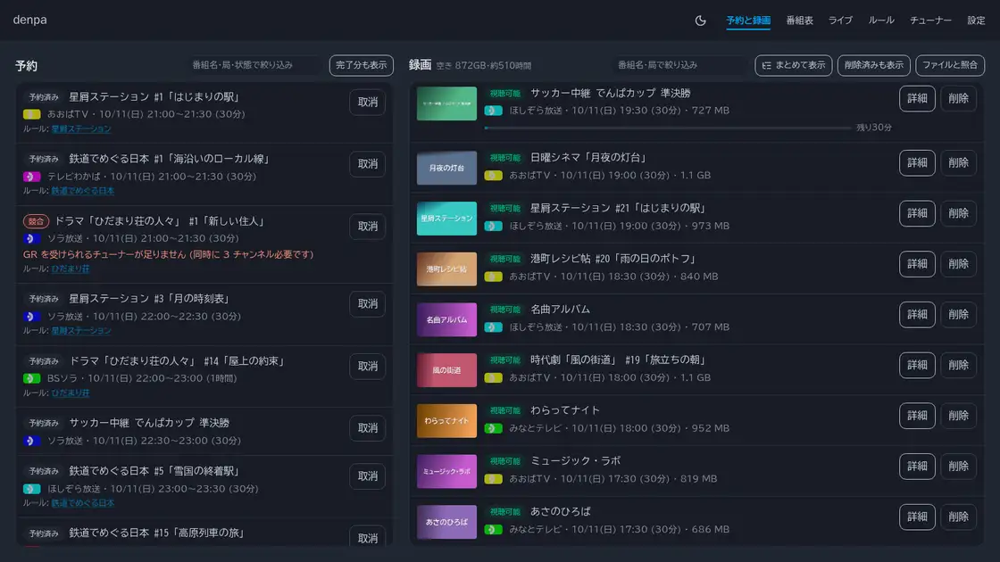
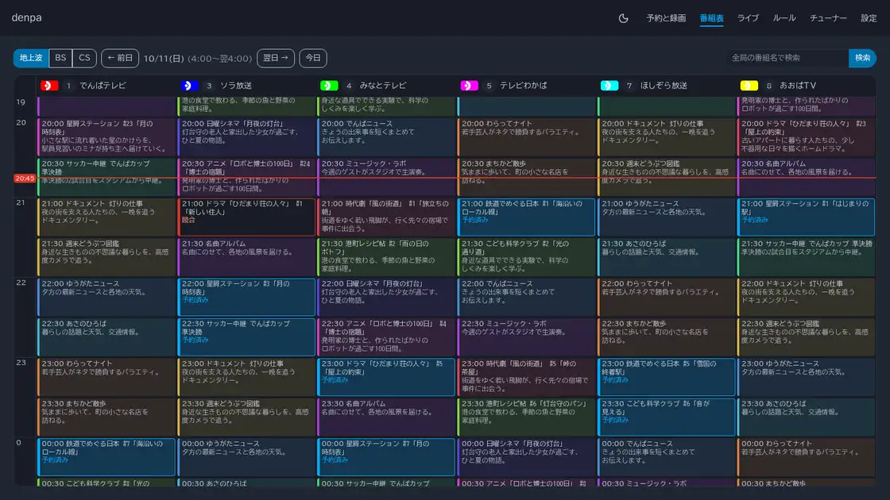
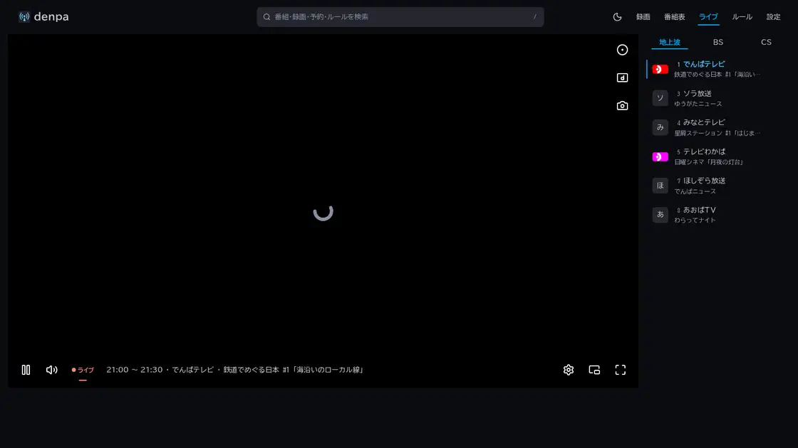
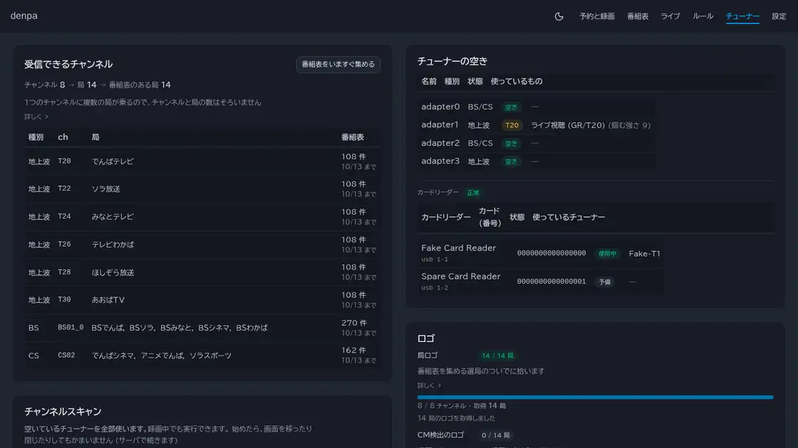
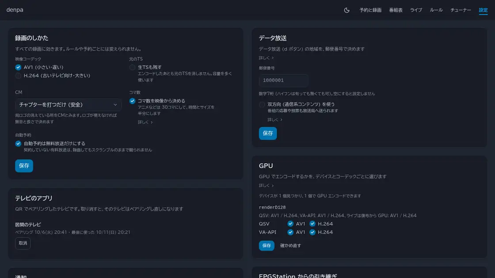

# 画面

偽の放送 (作り物の局・番組・映像) で撮った画像です。撮り直し方は [development.md](development.md#readme-の画像)。

立て方は [install.md](install.md)。

## 録画

予約と録画を**1本の一覧**に並べます。下へ行くほど時間が進みます。上から録れたもの (古い順)、
いま録っている行、赤い「いま」の線、これからの予約 (近い順) です。いまより前に始まったものは録画中も含めて線の上に来ます。
「いま」の線には時刻と、次の録画まで何分かを添えます。日付ごとに見出しが付き、
一覧の頭に貼り付きます。開いたときは、観終えていない録画があればいちばん古いものを映し
(溜まったぶんを古い順に片付けられるように)、無ければ「いま」の線を映します。

行は幅いっぱいの2段です。1段目に時刻と番組名、右に押すもの。2段目に局・尺・ルール・番組の説明の頭が入ります。
状態は言うことがあるときだけ3段目に出します。いま動いていること (録画中・エンコード中・エンコード待ち・端末に保存中) も、
止まっている問題 (競合・失敗・録り逃し・欠ける・CM の判定・削除済み・取り消し済みなど) も同じ形で、頭に点か印、状態、
「・」の後ろにあと何分か・進み・理由が続きます (「● 録画中・あと21分」「✕ 競合・チューナーが足りません」)。段は2つまでで、動いているものが先、
問題は重いものから。収まらないときは2段目に残りの状態をつなぎます (理由は詳細で読めます)。
動いているものは下端にバーも敷きます (録画は赤、エンコードは主の色、端末への保存は緑)。ふつうの状態 (予約済み・視聴可能) は出しません。
線も枠も無く、淡い地と行の間の隙間で1本ずつに見え、触れると少し濃く塗られます。行の高さはマウスで 64px、指で押す端末では 72px です。

録画の行は左にサムネイル (途中まで観たものは下端に細いバー) が付き、押せばその場で観る画面へ
(録っている最中のものは「いま」の線のすぐ上にいて、その行の「追っかけ」で追っかけ再生へ。[library.md](library.md#観るのはブラウザで))。
中身を読むときは行の ⓘ から。予約の行を押すと番組の詳細が開きます。

広い画面 (1000px 以上) では、右にサイドバーが出ます (頭の1行は出さず、一覧はいちばん上から始まります)。よく使うものほど上で、次の順です。
- **カレンダー**: 月の升目。行のある日に点が付き、押すとその日の見出しへ送ります。まとめて表示のときは出ません
- **状態**: エンコード (進みとあと何分か)・空き (あと何時間録れるかの目安)
- **絞り込み**: すべて・予約・録画中・未視聴。どれにも件数が付き、選んでいる行が薄く塗られます (未視聴は観終えていない録画。途中まで観たものも入ります)。
  続けて、競合・失敗・録り逃し・CMの判定 (ロゴで CM を判定できなかった録画) のうち件数のあるものが、注意の色とアイコンで出ます。押すとそれで絞られ、もう一度押すと戻ります
- **表示** (いちばん下): まとめて表示・完了した予約も表示・削除済みも表示 (右のスイッチ)、ファイルと照合 (→)。完了した予約のうち録画のあるものは録画の行1本にまとめ、録画の無いもの (取消など) だけを状態付きで出します

それより狭い画面 (タブレットの縦・スマホ) では、一覧の頭に細い1行を出します (スマホでは下のタブのすぐ上)。絞り込みのチップ (1回押せば絞れ、横に流せます) と、
その後ろに競合・失敗などのうち件数のあるものを注意の色のチップで。右の「⋯」の頭に状態 (押せません)、その下に表示の切り替えがあります。

狭い画面では、録画の行の詳細と削除は、番組名に幅を回すため右の「⋯」にまとめます。
番組名で探すのは、ホームではなく全体の検索です。

録画の行を押すと、そのまま観る画面へ:

予約や録画が溜まってきたら、「まとめて表示」で**番組ごと**にまとめられます
(端末ごとに覚えます)。まとめる単位は、エンコード済みの動画を置くシリーズのフォルダと同じです。
予約にも録画にも効き、同じ番組でも録画は「いま」の線の上、予約は線の下と、側ごとに別の見出しになります。録画中の行はまとめずに、録画の側の末尾 (線のすぐ上) にそのまま出ます
(番組の位置は、予約は次の回、録画は最新の回で決まります)。見出しを押すと放送順に開きます。
1本しか無い番組はまとめずにふつうの行のまま出ます。開いた番組の頭と、録画の詳細には
「ルールを作る」があり、シリーズ名を言葉にして検索の画面の「ルールとして保存」へ行きます
(既にその番組を録っているルールがあれば、作らずにそちらを案内します)。

「詳細」で番組の中身と操作。塗ったボタンは「再生」だけで、ほかに「端末に保存」
(オフライン視聴)、「ルールを作る」、「その他…」に視聴済みにする (未視聴に戻す)・再エンコード・CM検出のやり直し。閉じるのは左下の「閉じる」。狭い画面では下から出る一枚になり、ボタンは全幅で縦に並びます。
録画をファイルとして持ち出すダウンロードはありません ([library.md](library.md#観るのはブラウザで))。
コマ数 (30/60) や字幕の有無もここに出ます。

## 番組表

局ごとの縦の列。マスの左の線がジャンルの色で、予約済み・録画中は線の色が変わります。
上の1行 (スマホでは下) で日付を選び、朝・昼・夜へ送れます。「ジャンル」で色の見本を出し、押すとそのジャンルだけ目立ちます。
いまの線が引かれ、押せば詳細が開いてそこから予約・取消。番組を言葉で探すのは[検索](#検索)です。

コピー禁止の番組は録りません ([data.md](data.md#コピー禁止の番組は録らない))。マスと詳細に小さく
「コピー禁止」と出て、予約のボタンは出ません。ルールが当たった予約は「録画しない」になり、
予約の行に「コピー禁止の番組なので録画しません」と出ます。放送が終わっても録り逃しにはせず、「完了した予約も表示」で
理由ごと見られます。ライブの録画ボタンも同じ一文で断ります。
観るのはそのままできます。

BS/CS はロゴをカルーセルから取得して出します ([logo.ts](../src/lib/server/logo.ts))。

## ライブ

放送中のものをそのままブラウザで。映像・音声・字幕・データ放送が入っていて、
局は右の一覧から切り替え。止めれば追っかけ再生になります ([stream.md](stream.md))。

## 録画を観る

エンコード済みの録画をブラウザで (エンコード前・エンコードに失敗したものは、サーバがその場で変換して流します)。字幕は放送どおりの位置に重ね、CMは自動で飛ばします (1コマも見せません)。
シークバーの CM のところは琥珀色で分けます (denpa-tv と同じ色)。
右は番組の中身、下の操作バーに再生・字幕・速さ、映像の右端に縦に閉じる・切り抜き・削除。データ放送は「⚙」(再生の設定) から出します。

操作バーはライブ・追っかけと同じ作りで、ボタンはいつも1行に並べます。スマホの縦のように幅が足りないときは、
よく使うもの (観る画面は再生・チャプター送り・時刻・⚙・全画面、ライブと追っかけは再生・ライブ/最新・⚙・全画面) だけを残し、
音・字幕・速さ・小窓は「⚙」(再生の設定) の頭に行として入ります (「⋯」のボタンはありません)。
端末ごとに決めておくもの (CMスキップ・アンビエントモードなど) は、幅にかかわらず「⚙」に入っています ([watch.md](watch.md#操作バー))。
時刻も「0:31 / 1:00:00」だけの短い形にします。

## ルール

自動予約のルールの一覧と管理です。ルールは録画の一覧と同じ2段の淡い塊で並び、1段目に名前とスイッチ・削除、
2段目に条件 (探す所・局・同じ回は1度・除外)・次の放送・予約と録画の数・最後に録れた日が出ます。
広い画面では右のサイドバーで「すべて / 有効 / 無効 / 次の放送なし / 競合あり」の絞り込み (件数つき)・並び・集計 (これから7日の予約、この7日で録れた本数) を選べます。
それより狭いと絞り込みと並びは細い帯にまとまり、スマホでは画面の下 (タブのすぐ上) に出ます (スマホの2段目は次の放送と予約・録画の数だけ)。

有効/無効は行のスイッチで開かずに切り替えられ、削除は2回押しです (1回目で「削除を確定」に変わります)。
行を押すと、[検索](#ルールとして保存)の画面でそのルールを直せます。ルールを作るのも検索の画面の「ルールとして保存」からです (「ルールを作る」で開きます)。

「同じ回は最初の放送だけ」(新しく作るルールは入った状態で始まります) を入れておくと、
`[新]` のようなゆるい条件で拾っても、局を替えた再放送や同時放送は録りません。
同じ時刻に流れているなら字幕のあるもの、次に BS/CS を選びます。

## 検索

番組表・録画・予約・ルールを1つの言葉でまとめて探します。広い画面ではヘッダーの真ん中の欄から
(どこからでも `/` か Ctrl+K (Mac は ⌘+K) で入れます。入力欄で字を打っている間は効きません)、
スマホの幅では下のタブの「検索」から (上の帯に同じ欄が出て、欄に入った状態で開きます)。
打つそばから欄の下に候補が出ます (節ごとに数件。↑/↓ で選んで Enter で開き、何も選ばずに Enter ならすべての結果、Esc で閉じます)。
結果の画面にも同じ欄がそのままあり、打つそばから結果が変わります (Enter は要りません)。
結果の URL (`/search?q=…`) はそのまま人に渡せます。

結果は「これからの放送」「録画」「予約」「ルール」に分かれ、それぞれ件数と先頭の5件を出します (残りは「もっと見る」)。
読み方はどれも同じで、空白で区切った語をすべて含むものが当たります (全角/半角・大文字/小文字は区別しません)。
- **これからの放送** … 番組名と概要に当たる、まだ終わっていない番組。行から予約・取消。行を押すと番組の詳細 (「ルールを作る」はその番組のシリーズ名で右の書く欄を始めます)。
  右の書く欄の条件で録るかどうかを行ごとに出します (下の「ルールとして保存」)
- **録画** … 番組名・シリーズ・副題・局名に当たる録画。押せば観る画面へ (録っている最中のものは追っかけ再生へ)。削除もここから
- **予約** … これから録るものといま録っているもの。押せば詳細、取消もここから
- **ルール** … 名前とキーワードに当たるルール。押せば右の書く欄でそのルールを直せます

言葉なしで開くと、その端末で最近探した言葉が並びます (サーバには送りません)。

### ルールとして保存

探した言葉から、その場で自動予約のルールを作ります。広い画面では結果の右の列、スマホの幅では下の「ルールとして保存」から下に出ます。
キーワード (探した言葉から始まります)・探す所 (番組名/概要/詳細)・除外する言葉・局・同じ回は最初の放送だけ・優先度を選べます。
ジャンルは畳んだ行にあり、ふだんは「すべて」のままで構いません。

条件を変えると、結果の「これからの放送」の行ごとに **録る** / **録らない** (同じ回・除外・局・取り消し済みなどの理由つき。薄く出ます) / 予約済み がすぐ変わります。
判定は予約を立てるときと同じものです。下の「N 件を録るルールを保存」で保存し、保存したルールへのリンクが出ます。

ルールを直すときは `/search?rule=<ID>` で開きます (ルールの一覧の行や、検索の「ルール」から)。「編集中: <名前>」と出て、
「更新」・「無効化」・「削除」(2回押し) が並びます。言葉なしで開くと、結果の代わりにそのルールで録る番組が並びます (行を押すと番組の詳細、予約の立っている行は「取消」、録る行は「予約」でその1本だけ扱えます)。URL はそのまま渡せて、戻るでも戻れます。

## 設定

左にグループとその節の一覧、右にグループの画面が並びます。グループごとに1つの画面 (`/settings/<グループ>`) で、節は上から積んであります。
一覧の節を押すとその節まで滑らかに巻き (`/settings/<グループ>#<節>`)、巻いていくと見えている節が一覧で塗られます。戻る・進むもそのまま使えます。
スマホの幅では一覧 (グループだけ) が先に出て、押すとその画面に切り替わります。画面の上に「← 設定」と節の名前の行があり、巻いても残ります。広い画面で「設定」を開くと、先頭の「録画」が開きます。

| グループ              | 節                                    | 中身                                                                                                                                                                                                                                                                                                                                                                                         |
| --------------------- | ------------------------------------- | -------------------------------------------------------------------------------------------------------------------------------------------------------------------------------------------------------------------------------------------------------------------------------------------------------------------------------------------------------------------------------------------- |
| 録画 (`recording`)    | エンコード (`encoding`)               | コーデックとそのエンコーダ (ソフトウェア・GPU)・同時に変換する本数・元のTSを残すか・コマ数                                                                                                                                                                                                                                                                                                   |
|                       | CM (`cm`)                             | CMの扱い                                                                                                                                                                                                                                                                                                                                                                                     |
|                       | 自動予約 (`reserve`)                  | 無料放送だけにするか                                                                                                                                                                                                                                                                                                                                                                         |
| 受信 (`reception`)    | チューナー (`tuners`)                 | 1台1行の表 (受信できる種別・空きと使っている相手・「使う」のスイッチ。名前・デバイス・LNB と削除は「⋯」) とカードリーダー。**うまくいかないときはまずここ**                                                                                                                                                                                                                                  |
|                       | チャンネル (`channels`)               | 受信できるチャンネルと番組表の集まり具合。1行に1局で、局ロゴとCM検出のために覚えたロゴ (CMロゴ) の列もここ (押すと大きく見られ、「覚え直す」はその窓の中。狭い画面ではロゴを局名の前に出す)。チャンネルスキャン (種別を選んで「スキャン」。回っている間は「中断」)・「番組表をいますぐ集める」・「ロゴをいますぐ集める」は見出しの行にあります。前の「ロゴ」の節 (`#logos`) はここへ送ります |
|                       | データ放送 (`broadcast`)              | 郵便番号と都道府県・双方向                                                                                                                                                                                                                                                                                                                                                                   |
| 連携 (`integrations`) | 通知 (`notifications`)                | 通知先 (Webhook)                                                                                                                                                                                                                                                                                                                                                                             |
|                       | テレビのアプリ (`tv`)                 | ペアリングしたテレビ                                                                                                                                                                                                                                                                                                                                                                         |
|                       | EPGStation からの引き継ぎ (`migrate`) |                                                                                                                                                                                                                                                                                                                                                                                              |
| その他 (`general`)    | この端末 (`browser`)                  | 画面の高さを見る (端末ごと)。テーマはヘッダー (スマホは下の「その他」)、互換モードは再生画面の ⚙ で切り替えるので、ここには置きません                                                                                                                                                                                                                                                        |
|                       | ログイン (`login`)                    | ログアウト・ほかの端末からもログアウト (ログインして使っているときだけ。素通しではその旨の1行)                                                                                                                                                                                                                                                                                               |
|                       | バージョン (`version`)                | 動いている版。新しい版のリンクはヘッダー (スマホは「その他」) に出ます                                                                                                                                                                                                                                                                                                                       |

説明は要点1行で、続きは「詳しく」に畳んであります。前の節ごとの画面 (`/settings/tuners` など) と前のチューナーの画面 (`/tuners`) は、グループの画面のその節へ送ります。

### 局が無いとき

どの種別にも局が1つも無いと、録画・番組表・ライブの上に「チャンネルがありません。チャンネルスキャンをしてください」と1行出し、
[スキャンへ] で設定の「チャンネル」を開きます。閉じるボタンは無く、スキャンして局が入れば消えます。
地上波だけ無いとき (衛星だけの家) は出しません。番組表では、選んでいる種別に局が無ければ「地上波のチャンネルがありません。…」とボタンを表の場所の真ん中に出します (このときは上の1行を出しません)。
